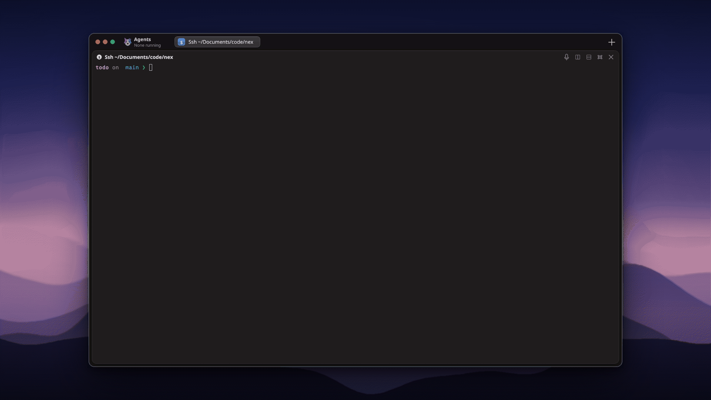
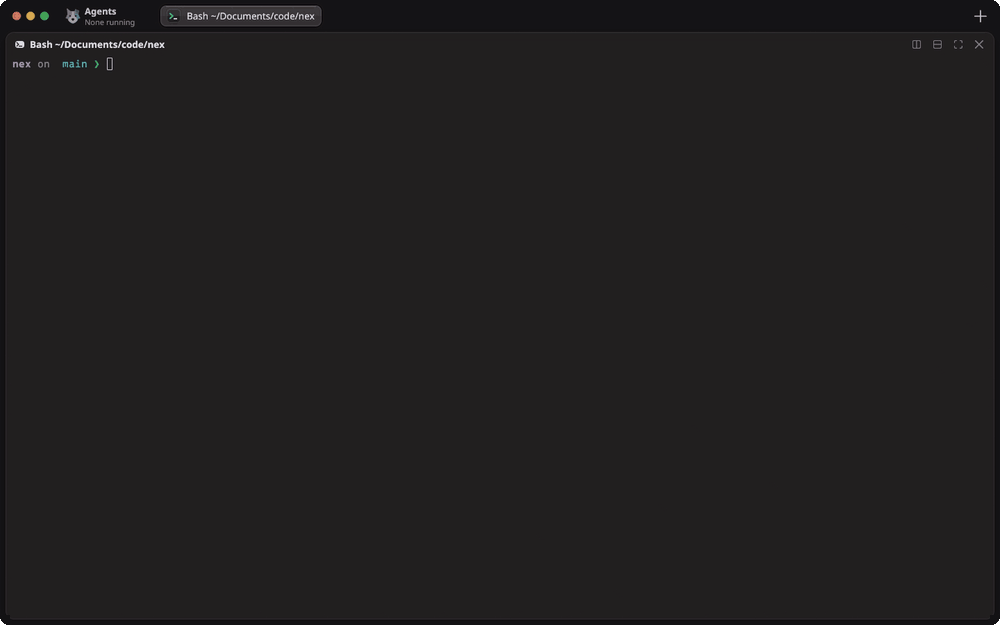
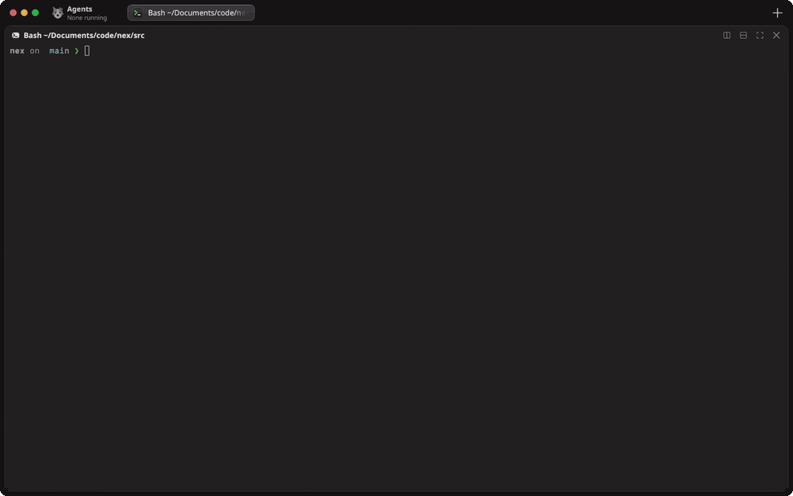

<!-- LOGO -->
<h1 align="center">
  
  <br>nex: GPU terminal emulator with AI agents, SSH, files and git built in
</h1>

<p align="center">
  <strong>A fast, GPU-accelerated terminal emulator for Linux, macOS and Android (iOS in beta), written in Rust.</strong>
  <br />
  Tabs, splits, a file explorer, git changes, an Agents pane for Claude Code and Codex, agent pipelines and SSH that follows you, built in. No tmux, no plugins, no setup.
  <br /><br />
  <a href="https://jramirez-codes.github.io/nex/"><strong>Website</strong></a>
  ·
  <a href="#installation">Install</a>
  ·
  <a href="#features">Features</a>
  ·
  <a href="#ssh-built-in">SSH</a>
  ·
  <a href="#agents">Agents</a>
  ·
  <a href="#nex-host-and-pipelines">Pipelines</a>
  ·
  <a href="#phone-apps">Phone apps</a>
  ·
  <a href="#how-does-nex-compare">Compare</a>
  ·
  <a href="#configuration">Configuration</a>
  ·
  <a href="#keybindings">Keybindings</a>
  ·
  <a href="#faq">FAQ</a>
</p>

<p align="center">
  <a href="https://github.com/jramirez-codes/nex/releases/latest"></a>
  <a href="https://github.com/jramirez-codes/nex/actions/workflows/ci.yml"></a>
  <a href="https://github.com/jramirez-codes/nex/stargazers"></a>
  <a href="LICENSE"></a>
  
  
</p>

<p align="center">
  
</p>

## About

**nex** is a free, open-source terminal emulator for Linux, macOS and
[Android](#phone-apps) (with an iPhone app in beta) that looks and feels like a native,
modern desktop app. Tabs live in the title bar, and every split pane is a rounded card with its
own header showing what's running and where. A file explorer opens right next to your shell,
and a Changes pane shows what git sees as changed. `ssh` sessions get the same treatment:
splits stay on the server, and files you drop or paste land on the remote host. Running
Claude Code or Codex? An Agents pane keeps every one in view, says which one needs you, and
can be pinned to every tab; on a server, agents keep running after their pane closes, and
pipelines chain them into a plan, build, review and merge run.
On a phone, the same window runs with every pane on your server.
The UI is drawn with the GPU, so typing, scrolling and resizing stay smooth even under heavy
TUIs like `btop`, `nvim` and `lazygit`.

It is built on [`alacritty_terminal`](https://crates.io/crates/alacritty_terminal), the same
battle-tested VT engine behind Alacritty and Zed's terminal. nex's own code covers the
rendering, input handling, multiplexing and window chrome. Demos and a feature tour are on
the [website](https://jramirez-codes.github.io/nex/).

> [!NOTE]
> nex is young. It runs on Linux (X11 and Wayland), macOS and Android; macOS support is
> newer, and the iPhone app is a beta you build yourself. Expect rough edges, and please
> [open an issue](https://github.com/jramirez-codes/nex/issues) when you hit one. If nex is
> useful to you, a ⭐ helps other people find it.

### Quick install

Grab a build from the [latest release](https://github.com/jramirez-codes/nex/releases/latest)
(full steps in [Installation](#installation)):

```sh
sudo apt install ./nex_*_amd64.deb                                       # Debian / Ubuntu
tar xzf nex-v*-x86_64-linux.tar.gz && ./nex-v*-x86_64-linux/install.sh   # any Linux
```

- **macOS:** open `nex-v*-macos.dmg` and drag `nex.app` to Applications. It's signed and
  notarized by Apple.
- **Android:** install `nex-v*-android-arm64.apk` on the phone.

### Why nex?

- **One window instead of three.** Tabs, split panes, a file explorer and a git Changes pane
  replace a terminal + tmux + file manager + diff viewer setup.
- **SSH without the busywork.** Split an `ssh` pane and you're on the same host, in the same
  folder. Drop a file or paste a screenshot into it and nex uploads it and types the remote
  path, so a remote Claude Code can open it. One login, no `scp`.
- **Your agents, in view.** One pane lists every Claude Code and Codex agent, in any tab or
  on any server, and which one needs you. Pin it with `Ctrl+Shift+P` and it follows you to
  every tab.
- **Agents that work together.** On a server, `nex-host` keeps agents running after their pane
  closes, lets them message each other, and runs [pipelines](#nex-host-and-pipelines) that
  build features in worktrees and merge the PRs one at a time.
- **Your terminal on your phone.** The [Android app](#phone-apps) puts nex's window on your
  phone with every pane on your server, and panes survive network drops.
- **Fast.** In [our benchmark](bench/README.md), nex printed 50 MB of output 1.8× faster than
  kitty and launched 25× faster than GNOME Terminal.
- **Works out of the box.** A Nerd Font is embedded, config applies on save, and the defaults
  are sensible.
- **Native-feeling.** Glass tab pills, per-pane headers with app icons, smooth animations, and
  touch and pinch support.

## How does nex compare?

|                                         | nex | Alacritty | kitty    | Ghostty  | GNOME Terminal |
| --------------------------------------- | :-: | :-------: | :------: | :------: | :------------: |
| GPU-rendered                            | ✅  | ✅        | ✅       | ✅       | ❌             |
| Tabs                                    | ✅  | ❌        | ✅       | ✅       | ✅             |
| Split panes                             | ✅  | ❌        | ✅       | ✅       | ❌             |
| Agents pane (Claude Code, Codex)        | ✅  | ❌        | ❌       | ❌       | ❌             |
| Agent pipelines and teams               | ✅  | ❌        | ❌       | ❌       | ❌             |
| Pin a pane to every tab                 | ✅  | ❌        | ❌       | ❌       | ❌             |
| Built-in file explorer                  | ✅  | ❌        | ❌       | ❌       | ❌             |
| Splits and tabs follow `ssh` sessions   | ✅  | ❌        | Kitten¹  | ❌       | ❌             |
| Drop / paste files into `ssh` sessions  | ✅  | ❌        | ❌       | ❌       | ❌             |
| Per-pane headers (program + folder)     | ✅  | ❌        | ❌       | ❌       | ❌             |
| Nerd Font icons with nothing installed  | ✅  | ❌        | ✅       | ✅       | ❌             |
| Config applies on save                  | ✅  | ✅        | Shortcut | Shortcut | GUI only       |

¹ kitty can open new windows on the remote host when you connect with its `ssh` kitten instead
of plain `ssh`. nex works with the `ssh` you already run.

### Performance

Median of several runs on the same machine (Ryzen 7 3700X, RTX 3060, Wayland), default
settings for each terminal. Lower is better. See [`bench/`](bench/README.md) to run it yourself.

| Benchmark                         | nex         | kitty   | Ghostty | GNOME Terminal |
| --------------------------------- | ----------- | ------- | ------- | -------------- |
| Print 50 MB of text, color, boxes | **0.76 s**  | 1.36 s  | 1.94 s  | 2.32 s         |
| Launch to shell                   | **13 ms**²  | 794 ms  | 376 ms  | 316 ms         |
| Memory at idle                    | 112 MB      | 142 MB  | 173 MB  | **62 MB**      |

² nex starts its first shell while the window is still opening, so the shell is ready before
the window is; the first frame appears about 120 ms after launch.

## SSH, built in

nex notices when a pane is running `ssh` and makes the rest of the window work with it. There
is no wrapper command: run `ssh` the way you always do. Following, uploads and the mic need
nothing installed on the server; for [agents](#agents-on-ssh-hosts) nex puts a small helper in
`~/.nex` there.

| You do this in an `ssh` pane                       | nex does this                                                                 |
| -------------------------------------------------- | ----------------------------------------------------------------------------- |
| Split it, or open a new tab                        | Opens another session on the **same host, in the same remote folder**         |
| Drop files or folders onto it                      | Copies them to a fresh temp folder on the host and **types the remote paths** |
| Paste a copied image or files (`Ctrl+V` / `Cmd+V`) | The same: uploads them and types the remote paths                             |
| Type `exit` in a followed split                    | Drops back to a local shell, just like the original pane                      |
| Press `Ctrl+E` / `Ctrl+G` in it                    | Opens Files / Changes **on the host**, in the session's folder                |
| Click its header's mic button (`Ctrl/Cmd+Shift+M`) | Makes **your microphone the host's default mic** (experimental)               |

This is what makes a remote [Claude Code](https://claude.com/claude-code) (or any program
that takes file paths) feel local: paste a screenshot into the pane and the remote program
gets a path it can open.

### How it works

- **Your own ssh, reused.** Uploads and new sessions run `ssh` with the pane's own options
  (user, port, identity, jump hosts, `-o` settings), minus forwardings and the remote command.
  Files travel as one `tar` stream into a new folder under the remote `$TMPDIR` (or `/tmp`).
- **Keys and agents just work.** If the host lets you in without typing anything, there's
  nothing to set up.
- **Password hosts: one login, shared.** Uploads never type a password. When a host asks for
  one, nex offers once to turn on connection sharing: it appends this block to the end of
  `~/.ssh/config`, so your own settings still win:

  ```ssh-config
  # Added by nex: ssh started in a nex pane shares its connection, ...
  Match exec "test x$TERM_PROGRAM = xnex"
    ControlMaster auto
    ControlPath ~/.ssh/nex-%C
    ControlPersist 60
  ```

  It only matches `ssh` started inside nex. Reconnect once, and from then on uploads and
  followed splits ride on the login you typed in the pane. Delete the block to undo it.
- **Safe fallbacks.** If an upload can't log in, nex types the local paths instead, as any
  terminal would. If it can't tell the remote folder, the new session opens in the remote home.

### Sharing your microphone (experimental)

Programs on an ssh host record from *that* machine, which usually has no microphone. That's
why Claude Code's voice mode says "Remote servers usually have none". Click the mic button
in the pane's header (or press `Ctrl+Shift+M`, `Cmd+Shift+M` on macOS), and the host's default
microphone becomes your local mic:

```text
PipeWire host: your mic ─▶ nex ─▶ ssh ─▶ pw-cat ("Microphone (shared by nex)") ─▶ PipeWire ─▶ the program
other Linux:   your mic ─▶ nex ─▶ a waiting ssh session (sh + dd) ─▶ ~/.nex/mic.fifo ─▶ ALSA default ─▶ the program
```

- **Off until something records.** Your mic starts only when a program on the host starts
  recording, and stops when it stops. The button is red while recording.
- **Nothing installed.** On a host running PipeWire, nex adds a source there and makes it the
  default while sharing, then puts the previous default back. Elsewhere it adds a marked block
  to `~/.asoundrc` and removes it when sharing stops (when you click again, close the last pane
  on that host, or quit). It needs a Linux host with PipeWire or `libasound2`.
- **Speech quality.** Audio goes out as 16 kHz mono, what speech recognizers use, starting
  about 0.2 s late to ride out network hiccups. Release Claude Code's push-to-talk a moment
  after you finish speaking: what's still on the way when it stops recording is lost.
- **Same login rules as uploads:** keys, agents and connection sharing work, and passwords
  aren't typed.
- `ssh-mic = auto` shares with every ssh pane nex can log in to without a password.

Without PipeWire, recording works best with `arecord` (Claude Code uses it on hosts without a
sound card): ALSA reads the shared mic in `arecord`'s block size.

**On Android**, hold the floating keyboard button in a terminal to talk to Claude Code's
voice mode (run `/voice` first). Claude Code records while Space is held, which the phone's
keyboard can't do (holding its Space moves its cursor), so the button does it: after about
half a second it turns red, shares the phone's microphone with the host over the app's own
connection, and sends Space as if held until you let go (and a moment longer, so your last
words arrive). The first time, Android asks to let nex use the microphone; allow it and hold
again. Taps, double-taps and drags work as before. `ssh-mic = off` turns this off too.

### Following your remote folder

To open splits in the folder you're in, nex needs the remote shell to say where it is. fish
does this out of the box, and so does Debian and Ubuntu's default bash prompt (through its
`user@host: dir` title). Elsewhere, add one line on the server:

```sh
# ~/.bashrc
PROMPT_COMMAND='printf "\e]7;file://%s%s\a" "$HOSTNAME" "$PWD"'${PROMPT_COMMAND:+";$PROMPT_COMMAND"}

# ~/.zshrc
chpwd() { printf '\e]7;file://%s%s\a' "$HOST" "$PWD" }; chpwd
```

### Turning it off

```ini
ssh-upload = false   # drops and pastes into an ssh pane type local paths, like other terminals
ssh-follow = false   # splits and new tabs of an ssh pane open a local shell
ssh-mic = off        # no mic button in ssh panes
```

## Features

- **Tabs and splits, built in.** Split right or down, zoom a pane, drag the gaps to resize,
  and move between splits with the keyboard. Drag a pane by its header to rearrange: onto
  another pane to swap them, onto an edge to put it on that side, onto the title bar to give
  it its own tab, or over another tab to move it there. Each pane's header has split, zoom
  and close buttons. You don't need tmux for layout.
- **File explorer, built in.** `Ctrl+E` splits a file explorer off the current pane, open at
  that pane's folder (`nex --explorer` opens nex as a file manager, on a Files tab). In a pane
  that's ssh'd into a host, it browses that host instead.
  Folders open in place, files open in their default app (or any app from Open With), and
  splitting an explorer starts a terminal in the folder you're looking at. Back / Forward,
  clickable breadcrumbs and a typed location bar with Tab completion get you around, and
  typing a name jumps to it.
- **Changes, built in.** `Ctrl+G` opens a Changes pane beside the current one: the files
  `git` sees as changed (staged and not) in a sidebar, and the selected file's diff as
  hunk cards with line numbers, word-level highlights and syntax colors taken from your
  palette. It works on ssh hosts too (git runs there). It follows the pane you're on, so
  focusing a terminal in another repository shows that one, and it refreshes as you work.
  `Ctrl+G` again closes it.
- **Agents at a glance.** Running Claude Code or Codex in a few panes? `Ctrl+Shift+A` opens an
  Agents pane: one card per agent with its task, folder and tab, and whether it needs you, is
  working, done or idle (and for how long). The label in the title bar opens it as a tab of
  its own and tells you at a glance when an agent is waiting. Click a card to jump to its pane.
- **Pin a pane to every tab.** `Ctrl+Shift+P` (or Shift + the header's ×) pins the focused
  pane, such as the Agents pane, so it shows beside whatever tab you switch to.
- **Agent pipelines.** `nex-host pipe feature "add a stats command"` starts builders in their
  own git worktrees and a reviewer that merges their PRs one at a time. See
  [nex-host and pipelines](#nex-host-and-pipelines).
- **Real file management.** List or grid view with icons for each kind of file, multi-select,
  and copy, cut and paste between explorers, with a right-click menu and an action bar. Rename
  in place, create folders and files, and see a file's Properties. Copies and moves show a
  live progress bar with a Cancel button. Drag files into another folder to move them, onto a
  terminal to type their paths, or drop them in from other apps. Name clashes get a `(2)`
  suffix instead of overwriting anything. Delete asks for confirmation first, since it's
  permanent.
- **SSH that follows you.** Splits and new tabs of an `ssh` pane stay on the server, in the
  same folder, and files you drop or paste into it are uploaded. See
  [SSH, built in](#ssh-built-in).
- **Image paste for Claude Code.** With an image on the clipboard, `Ctrl+V` reaches the
  program as `^V`, so Claude Code pastes the image itself. Images dragged in from a browser
  are saved to a temp file and their path typed.
- **Tabs that tell you when a program is waiting.** When a program rings the bell or sends a
  desktop notification (OSC 9, OSC 99 or OSC 777) in a tab you aren't looking at, a pulsing dot
  shows on the top-left corner of the tab's icon until you switch to that pane. If nex is in the background,
  the dock or taskbar flags it too. For Claude Code, see the [FAQ](#faq).
- **Touch and zoom.** Pinch (touchscreen or touchpad) or Ctrl+wheel zooms a terminal's font or
  an explorer's listing. In an explorer, drag to scroll, long-press to select, and drag the
  selection into another folder, explorer or terminal pane. In a terminal, swipe up or down to
  scroll (a quick swipe flings on), long-press to select a word and drag to extend it, and tap
  to focus. The Changes and Agents panes scroll with a finger too. Swipe sideways on any pane
  to go to the next or previous tab.
- **Native-feeling chrome.** Tabs sit in a segmented track with a raised "glass" active pill,
  glossy per-app icons and titles that fade out instead of being cut off.
- **Smart titles.** Every tab and pane shows the foreground program and its directory, such as
  `Node ~/code/nex`, or the title the program sets itself.
- **GPU rendering.** Text is batched into styled runs. Box-drawing, block, braille and
  Powerline glyphs are drawn as geometry, so TUI borders and graphs line up exactly.
- **Nerd Fonts out of the box.** JetBrains Mono Nerd Font Mono is built in, so icons in nvim,
  starship and lazygit work with nothing installed. An installed Nerd Font Mono is used if
  present.
- **Full color.** 16, 256 and 24-bit truecolor, with bold, italic, underline (including
  double), strikethrough, dim and inverse.
- **Scrollback search.** `Ctrl+Shift+F` opens a floating search field that highlights every
  match and steps through them.
- **Clickable links.** Ctrl+hover underlines URLs and OSC 8 hyperlinks, and Ctrl+click opens
  them.
- **Mouse everywhere.** Selection (word, line and block), SGR mouse reporting for TUIs,
  alternate-scroll for `less` and `man`, and bracketed paste.
- **Simple config.** Ghostty-style `key = value` file that applies as soon as you save it.

<p align="center">
  
</p>

<p align="center">
  
</p>

<p align="center">
  
</p>

## nex-host and pipelines

`nex-host` is nex's small helper on a server (nex installs it in `~/.nex/bin` on the hosts you
ssh into; see [Agents on ssh hosts](#agents-on-ssh-hosts)). Besides keeping agents running
after their pane closes, it lets Claude Code and Codex agents hand each other work and report
back, and runs **pipelines**: a plan, build, review and merge run made of agents, defined in a
TOML file. Everything shows up in the Agents pane, grouped by pipeline.

| Command                                         | What it does                                                    |
| ----------------------------------------------- | --------------------------------------------------------------- |
| `nex-host spawn NAME [--kind claude\|codex] [--worktree] TASK` | Start an agent on a task; it reports back with `done` |
| `nex-host send TO TEXT [--ask \| --task]`        | Message an agent; it's typed into its input                     |
| `nex-host done TEXT [--verdict approved\|changes\|failed] [--pr N]` | Report on your task to whoever gave it        |
| `nex-host recv [--from WHO] [--timeout 10m]`    | Wait for a message (for scripts)                                |
| `nex-host read WHO [--lines N]`                 | An agent's screen as text                                       |
| `nex-host ls`                                   | What's running                                                  |
| `nex-host pipe NAME "TASK" [--bg]`, `pipe ls`   | Run a pipeline, or list the ones there are                      |
| `nex-host worktree ls`, `worktree prune [--all] [--dry-run]` | The worktrees agents made; prune removes the unused, clean ones whose branch is merged |
| `nex-host skill`, `skill install`               | Print the manual for agents, or install it for Claude Code and Codex |

`TO` and `WHO` are an agent's id or name, `@parent`, `@children`, `@task` or `user`. Messages
arrive in the agent's input as a `<nex-message>` block that says who sent it and how to reply.
Run `nex-host help` for every option.

### Pipelines

A pipeline is a file at `.nex/pipelines/NAME.toml` in the repository (or a folder above it),
or `~/.config/nex/pipelines/NAME.toml` for every repository. Run it from the repository (here
`review-loop` is the example below, and `feature` is
[the one in `nex-host/examples`](nex-host/examples/feature/pipeline.toml)):

```sh
nex-host pipe review-loop "add a --json flag to the list command"
nex-host pipe feature "add a stats command" --bg    # in the background; watch it in the Agents pane
nex-host pipe ls                                    # the pipelines it can find
```

Stages run in order, each an agent that finishes with `nex-host done`. A stage's task can use
`{task}`, and an earlier stage's report as `{stage}`, `{stage.verdict}`, `{stage.files}` or
`{stage.pr}`:

```toml
timeout = "90m"                  # how long a stage may take (default 2h)

[[stage]]
name = "plan"
task = "Plan this, without writing code: {task}"

[[stage]]
name = "build"
worktree = true                  # a git worktree and branch of its own
task = """
Build this: {task}
The plan: {plan}
Commit, open a PR, and finish with nex-host done "<what you built>" --pr <its number>
"""

[[stage]]
name = "tests"
parallel = true                  # runs at the same time as "build"
kind = "codex"
task = "Write tests for this, in their own files: {task}"

[[stage]]
name = "review"
task = """
Review PR {build.pr}. Finish with
nex-host done "<what to fix, or why it's good>" --verdict approved|changes
"""
retry = { stage = "build", max = 3 }   # back to "build" unless approved
```

- `parallel = true` runs a stage alongside the one before it.
- `retry` sends the run back to an earlier stage (or this one) unless this stage's verdict is
  `unless` (default `approved`), at most `max` times (default 3).
- `each = true` on the last stage makes it a **merge queue**: one agent takes every report
  from the stages before it, first come first served, one at a time. Running the same
  pipeline again from the repository joins the run instead of starting another, so several
  features share one reviewer and one line of PRs.
- `command = ["claude", "--dangerously-skip-permissions"]` runs a stage with your own program
  and flags; `kind` (`claude` or `codex`) picks the agent otherwise.

Three ready-made examples: [`nex-host/examples/feature`](nex-host/examples/feature/pipeline.toml)
builds each feature in a worktree, opens a PR and has one reviewer merge them one at a time;
[`nex-host/examples/mockups`](nex-host/examples/mockups/pipeline.toml) has three designers
sketch a brief as HTML mockups in different directions and a critic rank them;
[`nex-host/examples/pr-team`](nex-host/examples/pr-team/README.md) sets up a toy repository
with three builders and a merger to try it end to end.

## Phone apps

### Android

The Android app runs only nex's window on the phone; every pane works on an ssh host, such as
your home server, and nothing else runs on the device.

- **Connect screen.** Enter the host, user and password once and trust the host's key. The
  app then adds a key for this device to the host's `~/.ssh/authorized_keys`, set to expire
  after `device-key-days` (30 by default), and logs in with it from then on.
- **Panes survive network drops.** Each pane's shell is a `nex-host` session on the host, so
  switching apps or networks loses nothing: the pane reconnects and the screen comes back.
- **A keyboard button made for terminals.** The round button in the bottom-right corner
  hides or shows the keyboard. Drag it as a joystick for the arrow keys (they repeat faster
  the further you push), spin it round in a full circle for Esc, double-tap it to arm Ctrl for the next key (double-tap, then `c`, is
  `^C`), and feel a light haptic tick on taps, arrows and Ctrl.
- **Talk to Claude Code.** Hold the keyboard button to use Claude Code's voice mode: the
  phone's microphone is shared with the host while Space is held for you (see
  [Sharing your microphone](#sharing-your-microphone-experimental)).
- **Swipe typing** on the on-screen keyboard types into the terminal, with corrections.
- **Tabs for a small screen.** The tab strip scrolls sideways; long-press a tab, then drag,
  to reorder it. Swipe sideways on a pane for the next or previous tab.
- **Agents, Files and Changes.** The Agents pane lists the agents on the server over the
  app's own connection; opening one attaches to it, and closing it only detaches. Files and
  Changes open on the server too.

Get the APK from [Releases](#android-apk) or build it from source: see
[`nex-android/README.md`](nex-android/README.md).

### iPhone (beta)

The iPhone app works the same way: nex's window on the phone, every pane on an ssh host. It
draws with wgpu on Metal. There is no download yet; you build and sign it yourself (see
[iOS (beta)](#ios-beta)). Some things don't work yet, such as opening links in Safari.

## Installation

Downloads, release notes and a tour are also on the [website](https://jramirez-codes.github.io/nex/).

### Prebuilt releases

Download the latest build for x86_64 or aarch64 from the
[Releases page](https://github.com/jramirez-codes/nex/releases/latest).

**Debian / Ubuntu:**

```sh
sudo apt install ./nex_*_amd64.deb      # or nex_*_arm64.deb
```

**Any Linux (tarball):**

```sh
tar xzf nex-v*-x86_64-linux.tar.gz
./nex-v*-x86_64-linux/install.sh         # installs to ~/.local (override with PREFIX=...)
```

**macOS (Apple Silicon and Intel):** open `nex-v*-macos.dmg` and drag `nex.app` to
Applications. It's signed and notarized by Apple, so it opens without a warning.
`nex-v*-macos-app.zip` holds the same app if you'd rather not use the DMG.

Or use the tarball, which installs `nex.app` and the `nex` command. The app it builds isn't
notarized, so clear the download flag once first:

```sh
tar xzf nex-v*-universal-macos.tar.gz
xattr -dr com.apple.quarantine nex-v*-universal-macos
./nex-v*-universal-macos/install.sh       # nex.app + ~/.local/bin/nex
```

Each release includes a `SHA256SUMS.txt` you can verify the downloads against.

### Android APK

Download `nex-v*-android-arm64.apk` from the
[Releases page](https://github.com/jramirez-codes/nex/releases/latest) and open it on the
phone (allow installs from your browser or file manager when Android asks), or from a computer
with the phone plugged in:

```sh
adb install -r nex-v*-android-arm64.apk
```

To build it yourself, see [`nex-android/README.md`](nex-android/README.md). See
[Phone apps](#phone-apps) for what it does.

### iOS (beta)

There's no download yet. Build it yourself with
[`nex-ios/build-ipa.sh`](nex-ios/build-ipa.sh) on a Mac with Xcode 15 or newer; installing on
a real iPhone needs an Apple Developer Program membership. Steps, the Simulator and TestFlight
are in [`nex-ios/README.md`](nex-ios/README.md). It's a beta: links don't open in Safari yet,
among other gaps listed there.

### From source

You need Rust 1.88+ and a few system libraries. On Debian/Ubuntu:

```sh
sudo apt install build-essential libxkbcommon-dev libwayland-dev libgl1-mesa-dev fontconfig
```

On macOS you only need the Xcode command line tools (`xcode-select --install`).

Then build and install:

```sh
git clone https://github.com/jramirez-codes/nex.git
cd nex
./install.sh
```

`install.sh` builds a release binary and installs:

- the binary to `~/.local/bin/nex`;
- on Linux, a desktop entry and icon, so nex appears in your app launcher (GNOME, KDE, rofi
  and others);
- on macOS, `nex.app` in `/Applications` (or `~/Applications`; set `APP_DIR=...` to choose);
- a starter config at `~/.config/nex/config`, unless you already have one.

To run it without installing:

```sh
cargo run --release
```

## Configuration

nex reads `~/.config/nex/config` (or `$XDG_CONFIG_HOME/nex/config`), on macOS too. The
syntax is Ghostty-style `key = value`, and `#` starts a comment. Changes apply as soon as you
save the file, or press `Ctrl+Shift+,` (`Cmd+Shift+,` on macOS) to reload it by hand. `command` only affects shells started
after the change.

```ini
font-family = JetBrainsMono Nerd Font Mono   # unset = auto-pick a Nerd Font Mono
font-size = 14
adjust-cell-height = 12%

background = #1f1b1e
foreground = #d9d4dd
palette = 4=#6cb6ff                          # override any of the 16 ANSI colors
tab-attention-color = #ffcc66                # dot on a tab waiting for input (unset = palette 3)

background-opacity = 0.90
unfocused-split-opacity = 0.90
cursor-style = block                         # block | bar | underline
window-controls = false                      # hide the close / minimize / maximize buttons
copy-on-select = false
clipboard-toasts = false                     # no "Copied …" / "Pasted …" toasts
ssh-upload = false                           # type local paths for drops into an ssh pane
ssh-follow = false                           # splits of an ssh pane open a local shell
animations = false                           # turn off pane and tab animations
tab-animation = ink                          # switching tabs: glide (default) | ink | none
explorer-view = grid                         # file explorers open as a grid (default: list)
tab-bar = sidebar                            # tabs in a left sidebar, for touch screens (default: top)
agents-tab = icon                            # the Agents tab as just the dog, with a needs-you count (default: full; icon on Android)
restore-session = false                      # start with one fresh shell instead of the last window
system-notifications = true                  # notify when an agent needs you or a pipeline finishes (default: off)
command = fish                               # defaults to your login shell
```

See [`config.example`](config.example) for every option.

### Command line

```sh
nex --config ~/kiosk.conf          # another config file instead of ~/.config/nex/config
nex --app-id=dev.me.Scratch        # Wayland app_id (X11 class), for window rules
nex --working-directory ~/code     # where the first shell starts
nex -e htop                        # run a program instead of the shell (the rest of the line)
nex --explorer                     # open on the Files tab
nex ~/Downloads                    # open the Files tab in a folder (a path or file:// URI)
nex --select=~/Downloads/a.pdf     # open the Files tab in its folder, with it selected
nex --remote=me@home.lan           # every pane on that host, with nex's own ssh client
```

`--remote` is what the phone apps do (see [Phone apps](#phone-apps)). The first
time, you type your password once. nex then adds a key for this device to the host's
`~/.ssh/authorized_keys`, set to expire after `device-key-days` (30 by default), and logs in
with that key from then on. Each pane's shell is a `nex-host` session on the host, so a dropped
connection loses nothing: the pane reconnects and the screen comes back as it was.

`-e` only applies to the first pane; new tabs and splits start your shell. The window closes
when the program exits. A new window (`Ctrl+Shift+N`, `Cmd+N` on macOS) keeps `--config` and
`--app-id`.

A plain `nex` brings back the last window: every tab and split, each pane's folder and zoom,
and the Files tab. Terminals start a fresh shell in their folder (no scrollback), and a pane
that was running something (`npm run dev`, `ssh host`) runs it again there; Claude Code picks up
the same conversation (`claude --resume`). Programs are started again, not reattached, so what
was only in their memory is gone. Closing every
tab makes the next launch start fresh; `-e`, a folder, `--working-directory`, `--explorer` and
new windows never restore, nor does a second `nex` while one is already running. Turn it off with `restore-session = false`.

> [!TIP]
> Translucent backgrounds look best with compositor blur. On Hyprland, set
> `decoration { blur { enabled = true } }`.

## Keybindings

nex follows Ghostty's defaults on each OS. Both tables live in
[`src/app/input/keymap.rs`](src/app/input/keymap.rs).

| Action                 | Linux                                                 | macOS                                           |
| ---------------------- | ----------------------------------------------------- | ----------------------------------------------- |
| New tab / window       | `Ctrl+Shift+T` / `Ctrl+Shift+N`                       | `Cmd+T` / `Cmd+N`                               |
| Split right / down     | `Ctrl+Shift+O` / `Ctrl+Shift+E`                       | `Cmd+D` / `Cmd+Shift+D`                         |
| Close pane             | `Ctrl+Shift+W`                                        | `Cmd+W`                                         |
| Focus split            | `Ctrl+Alt+Arrows`                                     | `Cmd+Option+Arrows`                             |
| Swap with neighbor     | `Alt+Shift+Arrows`                                    | `Cmd+Shift+Option+Arrows`                       |
| Resize split           | `Ctrl+Shift+Alt+Arrows`                               | `Cmd+Ctrl+Arrows`                               |
| Equalize splits        | `Ctrl+Shift+Alt+=`                                    | `Cmd+Ctrl+=`                                    |
| Zoom pane              | `Ctrl+Shift+Enter`                                    | `Cmd+Shift+Enter`                               |
| Explorer split here    | `Ctrl+E`                                              | `Cmd+E`                                         |
| Changes (git diff)     | `Ctrl+G`                                              | `Cmd+G`                                         |
| Agents                 | `Ctrl+Shift+A`                                        | `Cmd+Shift+A`                                   |
| Pin pane to every tab  | `Ctrl+Shift+P`                                        | `Cmd+Shift+P`                                   |
| Next / previous tab    | `Ctrl+Tab` / `Ctrl+Shift+Tab`, `Ctrl+PgDn/PgUp`, `Ctrl+Shift+Right/Left` | `Cmd+Shift+]` / `Cmd+Shift+[`, `Ctrl+Tab`       |
| Go to tab *N*          | `Alt+1` … `Alt+8`, `Alt+9` for the last tab           | `Cmd+1` … `Cmd+8`, `Cmd+9` for the last tab     |
| Copy / paste           | `Ctrl+Shift+C` / `Ctrl+Shift+V`, `Shift+Insert`       | `Cmd+C` / `Cmd+V`                               |
| Search scrollback      | `Ctrl+Shift+F`, then `Enter` / `Shift+Enter`, `Esc`   | `Cmd+F`, then `Enter` / `Shift+Enter`, `Esc`    |
| Scroll                 | `Shift+PgUp/PgDn/Home/End`, mouse wheel               | the same, plus `Cmd+Up` / `Cmd+Down`            |
| Font size / zoom       | `Ctrl+=` / `Ctrl+-` / `Ctrl+0`, `Ctrl+wheel`, pinch   | `Cmd+=` / `Cmd+-` / `Cmd+0`, `Cmd+wheel`, pinch |
| Clear screen           | `Ctrl+Shift+K`                                        | `Cmd+K`                                         |
| Share mic over ssh     | `Ctrl+Shift+M`                                        | `Cmd+Shift+M`                                   |
| Reload config          | `Ctrl+Shift+,`                                        | `Cmd+Shift+,`                                   |
| Quit                   | `Ctrl+Shift+Q`                                        | `Cmd+Q`                                         |

On macOS, `Ctrl+C` and other Ctrl keys always go to the shell, and Option types accented
characters as usual (it isn't sent as Alt/Meta).

Mouse actions (use Cmd instead of Ctrl on macOS):

- Double-click selects a word, triple-click a line, and Alt+drag a block.
- Hold Shift to select text inside apps that capture the mouse.
- Ctrl+click opens a link.
- Middle-click closes a tab, and dragging a tab reorders it.
- Drag the gap between two panes to resize them.
- Drag a pane by its header onto another pane to swap the two (`Esc` cancels). With
  `pane-headers = false`, use the keyboard swap instead.
- Click the Agents label in the title bar (the one with the nex dog) to show the Agents tab, click it again to go back,
  and middle-click it to close it. Ctrl+Tab cycles through it too. When nex was opened as a
  file manager (`--explorer`, or a folder), the label is the Files tab instead.

### Changes

`Ctrl+G` (`Cmd+G` on macOS) opens or closes the Changes pane. It shows the repository of
whichever pane in the tab has focus and re-reads it every couple of seconds while on screen.
It never changes anything in the repository.

| Action                       | Keys / mouse                                          |
| ---------------------------- | ----------------------------------------------------- |
| Pick a file                  | `Up` / `Down` (or `j` / `k`), click                   |
| Move between list and diff   | `Tab`, `Left` / `Right` (or `h` / `l`)                |
| Scroll the diff              | `j` / `k`, `PgUp` / `PgDn`, `Space`, `g` / `G`, wheel  |
| Next / previous hunk         | `n` / `p` (or `Shift+N`)                              |
| All / unstaged / staged      | `1` / `2` / `3`, or the segmented control             |
| Show the file in Files       | `Enter` or `o`, double-click                          |
| Refresh                      | `r`, or the ↻ button                                  |
| Copy the file's path         | `Ctrl+Shift+C`                                        |
| Zoom the diff                | `Ctrl+=` / `Ctrl+-` / `Ctrl+0`, `Ctrl+wheel`, pinch   |

In a narrow pane the list and the diff take turns: `Enter` opens the diff, `Esc` goes back.

### Agents

`Ctrl+Shift+A` (`Cmd+Shift+A` on macOS) opens or closes the Agents pane; the title bar's label
opens it as a tab of its own. It lists every Claude Code and Codex agent running in a nex pane,
in any tab, most urgent first:

- **Needs you**: it rang the bell or sent a notification you haven't looked at, or Claude
  Code says it is waiting on you (a permission prompt).
- **Working**: Claude Code says it's busy (or its title spinner is turning); Codex is printing.
- **Done**: it finished while you weren't looking at its pane. It becomes Idle once you look.
- **Idle**: waiting at its prompt.

Claude Code's status and session name come from its own session file
(`~/.claude/sessions/<pid>.json`); a card is titled with the task Claude Code puts in the
terminal title when there is one.

An agent running sub-agents (Claude Code's Task tool, or threads Codex spawns) gets a team
card: each sub-agent is a capsule saying what it was asked to do, open the card to list them.
Sub-agents look and work like a pipeline's stages: tagged by their type, each hanging off
its agent in the open card. Clicking a sub-agent's capsule or its row (or `Enter` / `Space` on
its row) opens it in a terminal tab of its own, and clicking it again focuses that tab. A
sub-agent runs inside its agent's process and has no terminal, so its tab shows its
transcript, live and read-only: the task it was given, what it says, each tool call on one
line and the start of each result, then "Finished" once it's done. While its tab is on
screen, its row gets the Viewing ring. Closing the tab closes only the view. A finished
sub-agent shows a tick for two minutes, then drops off the pane; a tab already showing it
keeps its transcript. In a pipeline, a stage's sub-agents sit under that stage (its capsule says how
many) rather than among the steps. Claude Code's come from the files it keeps beside each
conversation (`~/.claude/projects/<folder>/<session>/subagents/`); Codex's from its rollouts
(`~/.codex/sessions/`).

| Action                       | Keys / mouse                                          |
| ---------------------------- | ----------------------------------------------------- |
| Pick an agent                | Arrows (or `h` / `j` / `k` / `l`), `Home` / `End`     |
| Jump to its pane (a sub-agent's tab) | `Enter` or `Space`, click                     |
| Stop an agent on an ssh host (asks first) | `Delete` |

#### Agents on ssh hosts

Agents on your servers can keep running after their pane closes. When a pane connects to a host
with `ssh`, nex installs its small helper, `nex-host`, in `~/.nex` there. It needs no root, and
`rm -rf ~/.nex` removes it. nex then offers, once per host, to make `claude` and `codex` typed
in its ssh panes start through the helper. It adds a few marked lines to the host's `~/.bashrc`
or `~/.zshrc` (fish: a file in `~/.config/fish/conf.d`) that only act in nex. `command claude`
skips them, and `~/.nex/bin/nex-host shim remove` takes them out. Set `ssh-agent-shim` to `on`
to skip the question, or `off` to never be asked. You can also start one by hand with
`~/.nex/bin/nex-host run -- claude`.

An agent started either way keeps running when you close its pane, lose the connection or quit
nex. Its card stays in the Agents pane with its host, its folder and its
live status, marked **Detached**. Click the card to open a tab attached to it, with the screen
redrawn where it left off. Closing that tab only detaches it again. An agent whose program
ends drops off the list. `Delete` on a running one stops it, after asking. Hosts with agents are remembered, so their cards come back when nex restarts. A host nex
can't reach gets a line at the top of the pane saying why.

The shim knows it's in nex from `LC_TERMINAL=nex`, which ssh passes on to servers that accept
`LC_*` variables (Debian and Ubuntu do). On other servers, add `SendEnv LC_TERMINAL` to the host
in `~/.ssh/config` and `AcceptEnv LC_*` to its `sshd_config`.

nex's connections to the host never ask for a password. They work with keys or an ssh agent,
or by sharing a pane's login (nex offers to set that up). Set `ssh-agents = false` to turn all
of this off. See [`nex-host/README.md`](nex-host/README.md) for how it works.

### File explorer

On macOS, use Cmd where this table says Ctrl.

| Action                       | Keys / mouse                                          |
| ---------------------------- | ----------------------------------------------------- |
| Open an explorer split here  | `Ctrl+E`                                              |
| Move the selection           | Arrows, `PgUp/PgDn`, `Home/End`                       |
| Open folder or file          | `Enter`, double-click (or tap)                        |
| Parent folder                | `Backspace`, `Alt+Up`, or the ⌃ button                |
| Back / forward               | `Alt+Left` / `Alt+Right` (also `Cmd+[` / `Cmd+]` on macOS), mouse side buttons |
| Type a location              | `Ctrl+L`, or click beside the breadcrumbs; `Tab` completes |
| Jump to a name               | Start typing; `Up` / `Down` for the previous / next match |
| Rename                       | `F2`                                                  |
| New folder                   | `Ctrl+N` (`Cmd+Shift+N` on macOS)                      |
| Properties                   | `Alt+Enter` (`Cmd+I` on macOS)                         |
| Select                       | `Space`, Ctrl+click, Shift+click, `Ctrl+A`            |
| Copy / cut / paste files     | `Ctrl+C` / `Ctrl+X` / `Ctrl+V`                        |
| Clear selection / clipboard  | `Esc`                                                 |
| Delete (asks first)          | `Delete`                                              |
| List / grid view             | `Ctrl+Shift+G`                                        |
| Show hidden files            | `Ctrl+H`                                              |
| Zoom the listing             | `Ctrl+=` / `Ctrl+-` / `Ctrl+0`, `Ctrl+wheel`, pinch   |

- Right-click an item for Open, Open With, Open Terminal Here (folders), Copy, Cut, Paste into
  folder, Rename, Copy path, Properties and Delete. Right-click empty space for Paste here,
  Create Folder, Create Empty File, Open Terminal Here, the view options and the folder's
  Properties.
- Copies, moves and deletes run in the background: a progress bar along the action bar shows
  how much is done, with the time left and a Cancel button. A cancelled copy leaves no
  half-copied file behind.
- Drag files onto a folder to move them (hold Ctrl, or Option on macOS, to copy), or onto a
  terminal to type their shell-quoted paths. On Wayland, drags between windows (another nex,
  Thunar, Nautilus) move files too, with Ctrl to copy, and a folder updates as soon as a file
  leaves it. On macOS, files dropped in from another app are copied, and dragging files out
  isn't supported yet.
- On a touchscreen, drag to scroll and long-press to start selecting. Long-press and keep
  moving (or, while selecting, drag a selected item) to drag the selection onto a folder,
  another explorer or a terminal. The action bar's Delete button asks before deleting
  anything permanently.

## FAQ

**Is nex a tmux alternative?**
For layout, yes: split panes, zoom, resize and keyboard focus between splits are built in, and
every pane shows its program and folder. Splits of an `ssh` pane open on the same server, so
you don't need tmux on the remote side just to get a second shell there. Agents started
through `nex-host` keep running when the connection drops or the pane closes, and panes of
`nex --remote` and the phone apps reconnect to the same session. Plain `ssh` panes don't
detach, so keep tmux if you need other work to survive a dropped connection.

**How do I get a tab dot when Claude Code asks for input?**
You don't need to set anything. When an agent nex is tracking finishes or starts needing
input, its tab gets the dot on its own, and the agent's card moves to **Done** or **Needs
you** in the Agents pane. This also works over ssh, with no setup on the server. The dot
clears when you look at the pane. Claude Code doesn't recognise nex, so for its other
notifications, tell it to use the terminal bell:
`claude config set --global preferredNotifChannel terminal_bell` (or pick "Terminal Bell"
under Notifications in `/config`). `iterm2` (OSC 9) works too. Any other program that rings
the bell, such as `make; printf '\a'`, gets the same dot.

**Does nex need anything installed on my servers?**
Not for ssh itself: following, uploads and the mic use the `ssh` on your machine and plain
`sh` and `tar` on the server. For agents (`ssh-agents = true`, the default), nex installs its
small helper, `nex-host`, in `~/.nex` on hosts you ssh into: no root, and `rm -rf ~/.nex`
removes it. Set `ssh-agents = false` to skip that. For splits to
open in your current remote folder, the remote shell should report it (fish and Debian/Ubuntu
bash already do; see [Following your remote folder](#following-your-remote-folder)).

**Why does nex want to edit `~/.ssh/config`?**
Only if a host asks for a password, and only if you say yes. Uploads and followed splits can't
type your password, so nex offers connection sharing: a `Match` block at the end of the file
that applies only to `ssh` started inside nex, letting them reuse the login you typed. It's
marked `# Added by nex` and safe to delete.

**Does nex work on Wayland and X11?**
Yes, both, including tiling compositors like Hyprland and Sway. Prebuilt `.deb` packages and
tarballs are available for x86_64 and aarch64.

**Do I need to install a Nerd Font?**
No. JetBrains Mono Nerd Font is embedded, so icons in Neovim, starship and lazygit work out of
the box. An installed Nerd Font Mono is used instead if you have one.

**Is nex available on macOS, Windows or phones?**
macOS, yes: releases include `nex.app`, a universal build for Apple Silicon and Intel Macs
(see [Installation](#installation)), signed and notarized by Apple.
Android, yes: releases include an APK, and the iPhone app is a beta you build yourself (see
[Phone apps](#phone-apps)). Windows isn't supported yet, but the platform layer
(`src/platform/`) is set up for it.

**Can nex be my file manager?**
Yes. Installing nex (`install.sh` or the `.deb`) adds a hidden `nex-files.desktop` entry that
opens a folder on the Files tab. Make it the default handler for folders:

```sh
xdg-mime default nex-files.desktop inode/directory
```

After that, `xdg-open ~/Downloads` and apps that open folders through xdg-open start nex on the
Files tab. Add `explorer-view = grid` to your config to get the grid layout by default.

Apps that *show a file* ("Show in Folder" in Firefox and Chromium, "Reveal in File Explorer"
in VS Code) ask the file manager over D-Bus instead. To have nex answer those too, opening the
file's folder with the file selected, install with `NEX_FILE_MANAGER=1 ./install.sh`, or copy
`assets/org.freedesktop.FileManager1.service` to `~/.local/share/dbus-1/services/` with `Exec=`
set to nex's full path. The bus then starts `nex --file-manager-service` on the first request. To give those windows
the same `--config` or `--app-id` as your other nex windows, add them to the `Exec=` line
(`Exec=/usr/bin/nex --config=/path/to/config --file-manager-service`).
If another file manager is already running and answering, it keeps the job until it quits.

**How is nex related to Alacritty?**
nex uses `alacritty_terminal`, Alacritty's VT parser and grid, as its terminal engine. The
renderer, tabs, splits, file explorer and window chrome are nex's own.

## Architecture

How the code is laid out, the rules it follows, and where to start for common changes are in
[ARCHITECTURE.md](ARCHITECTURE.md). Building, testing, conventions and releasing are in
[CONTRIBUTING.md](CONTRIBUTING.md).

## Roadmap

### Done

- [x] Tabs, split panes, zoom, resize and keyboard focus between splits
- [x] Swap panes by dragging a header or with the keyboard
- [x] Built-in file explorer with copy / move progress, Open With, rename and Properties
- [x] Drag and drop between windows on Wayland (another nex, Thunar, Nautilus)
- [x] Tab, close, zoom and equalize animations (`glide` and `ink` tab switches)
- [x] Faster launch and lower idle memory
- [x] macOS support
- [x] macOS app bundle
- [x] Drop and paste files into `ssh` sessions
- [x] Splits and new tabs that follow `ssh` sessions
- [x] File manager mode (`nex --explorer`, default handler for folders)
- [x] Tab dot when a program rings the bell or sends a notification
- [x] Desktop notifications (OSC 9 / OSC 99 / OSC 777) light the tab dot
- [x] Restore tabs and splits on launch
- [x] Agents pane for Claude Code and Codex, with agents on ssh hosts that keep running
- [x] Changes pane (git diff) with syntax colors
- [x] Files and Changes panes on ssh hosts
- [x] `nex-host`: agents that message each other and report back
- [x] Agent pipelines, with worktrees and a merge queue
- [x] Pin a pane to every tab
- [x] Share your microphone with an ssh session
- [x] Click a sub-agent in the Agents pane to open its transcript in a tab of its own
- [x] Android app
- [x] iPhone app (beta)
- [x] Signed and notarized macOS app
- [x] Android: send Esc by spinning the joystick in a full circle

### Next

- [ ] Custom keybindings in the config file
- [ ] Shell integration (prompt marks, jump between prompts)
- [ ] Themes collection
- [ ] Command palette
- [ ] Color emoji
- [ ] Better animations when an agent, or several agents, close
- [ ] Android: download a file from the file explorer of an `ssh` session to the phone
- [ ] Clean up the agent code so each agent CLI (Claude Code, Codex, and any added later, such as Gemini CLI) is a self-contained module behind one shared interface

### Later

- [ ] Quick terminal (drop-down on a global hotkey)
- [ ] Bell options
- [ ] Inline images (kitty graphics protocol)
- [ ] Drag files out to Finder
- [ ] Windows support

## Acknowledgments

- [Alacritty](https://github.com/alacritty/alacritty) for `alacritty_terminal`, the VT parser
  and grid that power nex.
- [egui](https://github.com/emilk/egui) for immediate-mode GPU rendering.
- [Ghostty](https://ghostty.org) for the inspiration on defaults, keybindings and config style.
- [JetBrains Mono](https://www.jetbrains.com/lp/mono/) and [Nerd Fonts](https://www.nerdfonts.com),
  embedded under the [SIL Open Font License](assets/fonts/OFL.txt).

## License

nex is licensed under the [MIT License](LICENSE).
