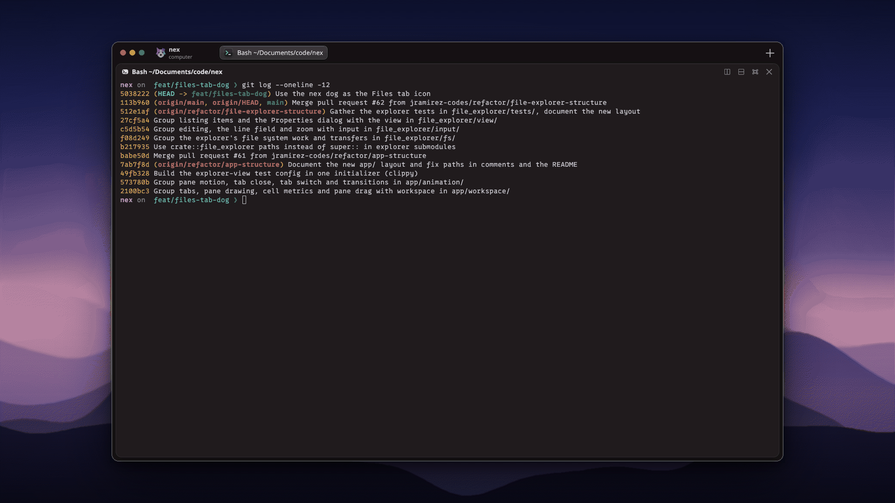
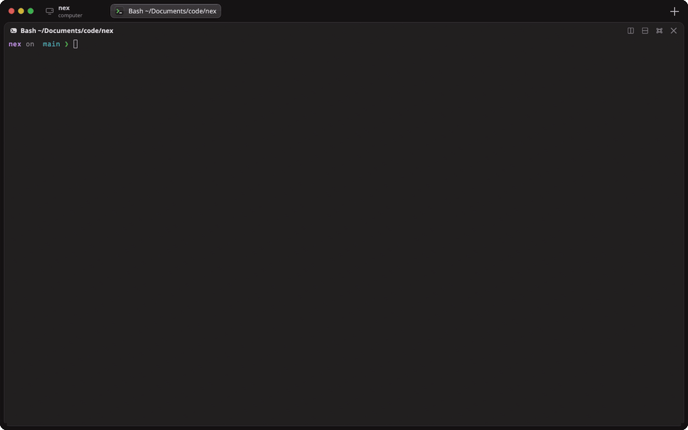

<!-- LOGO -->
<h1 align="center">
  
  <br>nex
</h1>

<p align="center">
  <strong>A fast, GPU-accelerated terminal emulator for Linux and macOS, written in Rust.</strong>
  <br />
  Tabs, split panes, a file explorer and SSH that follows you, built in. No tmux, no plugins, no setup.
  <br /><br />
  <a href="https://jramirez-codes.github.io/nex/"><strong>Website</strong></a>
  ·
  <a href="#installation">Install</a>
  ·
  <a href="#features">Features</a>
  ·
  <a href="#ssh-built-in">SSH</a>
  ·
  <a href="#how-does-nex-compare">Compare</a>
  ·
  <a href="#configuration">Configuration</a>
  ·
  <a href="#keybindings">Keybindings</a>
  ·
  <a href="#faq">FAQ</a>
</p>

<p align="center">
  <a href="https://github.com/jramirez-codes/nex/releases/latest"></a>
  <a href="https://github.com/jramirez-codes/nex/actions/workflows/ci.yml"></a>
  <a href="https://github.com/jramirez-codes/nex/stargazers"></a>
  <a href="LICENSE"></a>
  
  
</p>

<p align="center">
  
</p>

## About

**nex** is a free, open-source terminal emulator for Linux and macOS that looks and feels like a native,
modern desktop app. Tabs live in the title bar, and every split pane is a rounded card with its
own header showing what's running and where. A file explorer opens right next to your shell,
and `ssh` sessions get the same treatment: splits stay on the server, and files you drop or
paste land on the remote host.
The UI is drawn with the GPU, so typing, scrolling and resizing stay smooth even under heavy
TUIs like `btop`, `nvim` and `lazygit`.

It is built on [`alacritty_terminal`](https://crates.io/crates/alacritty_terminal), the same
battle-tested VT engine behind Alacritty and Zed's terminal. nex's own code covers the
rendering, input handling, multiplexing and window chrome.

> [!NOTE]
> nex is young. It runs on Linux (X11 and Wayland) and macOS; macOS support is newer.
> Expect rough edges, and please
> [open an issue](https://github.com/jramirez-codes/nex/issues) when you hit one. If nex is
> useful to you, a ⭐ helps other people find it.

### Why nex?

- **One window instead of three.** Tabs, split panes and a file explorer replace a terminal +
  tmux + file manager setup.
- **SSH without the busywork.** Split an `ssh` pane and you're on the same host, in the same
  folder. Drop a file or paste a screenshot into it and nex uploads it and types the remote
  path, so a remote Claude Code can open it. One login, no `scp`.
- **Fast.** In [our benchmark](bench/README.md), nex printed 50 MB of output 1.8× faster than
  kitty and launched 25× faster than GNOME Terminal.
- **Works out of the box.** A Nerd Font is embedded, config applies on save, and the defaults
  are sensible.
- **Native-feeling.** Glass tab pills, per-pane headers with app icons, smooth animations, and
  touch and pinch support.

## How does nex compare?

|                                         | nex | Alacritty | kitty    | Ghostty  | GNOME Terminal |
| --------------------------------------- | :-: | :-------: | :------: | :------: | :------------: |
| GPU-rendered                            | ✅  | ✅        | ✅       | ✅       | ❌             |
| Tabs                                    | ✅  | ❌        | ✅       | ✅       | ✅             |
| Split panes                             | ✅  | ❌        | ✅       | ✅       | ❌             |
| Built-in file explorer                  | ✅  | ❌        | ❌       | ❌       | ❌             |
| Splits and tabs follow `ssh` sessions   | ✅  | ❌        | Kitten¹  | ❌       | ❌             |
| Drop / paste files into `ssh` sessions  | ✅  | ❌        | ❌       | ❌       | ❌             |
| Per-pane headers (program + folder)     | ✅  | ❌        | ❌       | ❌       | ❌             |
| Nerd Font icons with nothing installed  | ✅  | ❌        | ✅       | ✅       | ❌             |
| Config applies on save                  | ✅  | ✅        | Shortcut | Shortcut | GUI only       |

¹ kitty can open new windows on the remote host when you connect with its `ssh` kitten instead
of plain `ssh`. nex works with the `ssh` you already run.

### Performance

Median of several runs on the same machine (Ryzen 7 3700X, RTX 3060, Wayland), default
settings for each terminal. Lower is better. See [`bench/`](bench/README.md) to run it yourself.

| Benchmark                         | nex         | kitty   | Ghostty | GNOME Terminal |
| --------------------------------- | ----------- | ------- | ------- | -------------- |
| Print 50 MB of text, color, boxes | **0.76 s**  | 1.36 s  | 1.94 s  | 2.32 s         |
| Launch to shell                   | **13 ms**²  | 794 ms  | 376 ms  | 316 ms         |
| Memory at idle                    | 112 MB      | 142 MB  | 173 MB  | **62 MB**      |

² nex starts its first shell while the window is still opening, so the shell is ready before
the window is; the first frame appears about 120 ms after launch.

## SSH, built in

nex notices when a pane is running `ssh` and makes the rest of the window work with it. There
is nothing to install on the server and no wrapper command: run `ssh` the way you always do.

| You do this in an `ssh` pane                       | nex does this                                                                 |
| -------------------------------------------------- | ----------------------------------------------------------------------------- |
| Split it, or open a new tab                        | Opens another session on the **same host, in the same remote folder**         |
| Drop files or folders onto it                      | Copies them to a fresh temp folder on the host and **types the remote paths** |
| Paste a copied image or files (`Ctrl+V` / `Cmd+V`) | The same: uploads them and types the remote paths                             |
| Type `exit` in a followed split                    | Drops back to a local shell, just like the original pane                      |
| Click its header's mic button (`Ctrl/Cmd+Shift+M`) | Makes **your microphone the host's default mic** (experimental)               |

This is what makes a remote [Claude Code](https://claude.com/claude-code) (or any program
that takes file paths) feel local: paste a screenshot into the pane and the remote program
gets a path it can open.

### How it works

- **Your own ssh, reused.** Uploads and new sessions run `ssh` with the pane's own options
  (user, port, identity, jump hosts, `-o` settings), minus forwardings and the remote command.
  Files travel as one `tar` stream into a new folder under the remote `$TMPDIR` (or `/tmp`).
- **Keys and agents just work.** If the host lets you in without typing anything, there's
  nothing to set up.
- **Password hosts: one login, shared.** Uploads never type a password. When a host asks for
  one, nex offers once to turn on connection sharing: it appends this block to the end of
  `~/.ssh/config`, so your own settings still win:

  ```ssh-config
  # Added by nex: ssh started in a nex pane shares its connection, ...
  Match exec "test x$TERM_PROGRAM = xnex"
    ControlMaster auto
    ControlPath ~/.ssh/nex-%C
    ControlPersist 60
  ```

  It only matches `ssh` started inside nex. Reconnect once, and from then on uploads and
  followed splits ride on the login you typed in the pane. Delete the block to undo it.
- **Safe fallbacks.** If an upload can't log in, nex types the local paths instead, as any
  terminal would. If it can't tell the remote folder, the new session opens in the remote home.

### Sharing your microphone (experimental)

Programs on an ssh host record from *that* machine, which usually has no microphone. That's
why Claude Code's voice mode says "Remote servers usually have none". Click the mic button
in the pane's header (or press `Ctrl+Shift+M`, `Cmd+Shift+M` on macOS), and the host's default
microphone becomes your local mic:

```text
PipeWire host: your mic ─▶ nex ─▶ ssh ─▶ pw-cat ("Microphone (shared by nex)") ─▶ PipeWire ─▶ the program
other Linux:   your mic ─▶ nex ─▶ a waiting ssh session (sh + dd) ─▶ ~/.nex/mic.fifo ─▶ ALSA default ─▶ the program
```

- **Off until something records.** Your mic starts only when a program on the host starts
  recording, and stops when it stops. The button is red while recording.
- **Nothing installed.** On a host running PipeWire, nex adds a source there and makes it the
  default while sharing, then puts the previous default back. Elsewhere it adds a marked block
  to `~/.asoundrc` and removes it when sharing stops (when you click again, close the last pane
  on that host, or quit). It needs a Linux host with PipeWire or `libasound2`.
- **Speech quality.** Audio goes out as 16 kHz mono, what speech recognizers use, starting
  about 0.2 s late to ride out network hiccups. Release Claude Code's push-to-talk a moment
  after you finish speaking: what's still on the way when it stops recording is lost.
- **Same login rules as uploads:** keys, agents and connection sharing work, and passwords
  aren't typed.
- `ssh-mic = auto` shares with every ssh pane nex can log in to without a password.

Without PipeWire, recording works best with `arecord` (Claude Code uses it on hosts without a
sound card): ALSA reads the shared mic in `arecord`'s block size.

### Following your remote folder

To open splits in the folder you're in, nex needs the remote shell to say where it is. fish
does this out of the box, and so does Debian and Ubuntu's default bash prompt (through its
`user@host: dir` title). Elsewhere, add one line on the server:

```sh
# ~/.bashrc
PROMPT_COMMAND='printf "\e]7;file://%s%s\a" "$HOSTNAME" "$PWD"'${PROMPT_COMMAND:+";$PROMPT_COMMAND"}

# ~/.zshrc
chpwd() { printf '\e]7;file://%s%s\a' "$HOST" "$PWD" }; chpwd
```

### Turning it off

```ini
ssh-upload = false   # drops and pastes into an ssh pane type local paths, like other terminals
ssh-follow = false   # splits and new tabs of an ssh pane open a local shell
ssh-mic = off        # no mic button in ssh panes
```

## Features

- **Tabs and splits, built in.** Split right or down, zoom a pane, drag the gaps to resize,
  and move between splits with the keyboard. Drag a pane by its header to rearrange: onto
  another pane to swap them, onto an edge to put it on that side, onto the title bar to give
  it its own tab, or over another tab to move it there. Each pane's header has split, zoom
  and close buttons. You don't need tmux for layout.
- **File explorer, built in.** `Ctrl+E` splits a file explorer off the current pane, open at
  that pane's folder. The directory label in the title bar is also a Files tab of its own.
  Folders open in place, files open in their default app (or any app from Open With), and
  splitting an explorer starts a terminal in the folder you're looking at. Back / Forward,
  clickable breadcrumbs and a typed location bar with Tab completion get you around, and
  typing a name jumps to it.
- **Real file management.** List or grid view with icons for each kind of file, multi-select,
  and copy, cut and paste between explorers, with a right-click menu and an action bar. Rename
  in place, create folders and files, and see a file's Properties. Copies and moves show a
  live progress bar with a Cancel button. Drag files into another folder to move them, onto a
  terminal to type their paths, or drop them in from other apps. Name clashes get a `(2)`
  suffix instead of overwriting anything. Delete asks for confirmation first, since it's
  permanent.
- **SSH that follows you.** Splits and new tabs of an `ssh` pane stay on the server, in the
  same folder, and files you drop or paste into it are uploaded. See
  [SSH, built in](#ssh-built-in).
- **Image paste for Claude Code.** With an image on the clipboard, `Ctrl+V` reaches the
  program as `^V`, so Claude Code pastes the image itself. Images dragged in from a browser
  are saved to a temp file and their path typed.
- **Tabs that tell you when a program is waiting.** When a program rings the bell or sends a
  desktop notification (OSC 9, OSC 99 or OSC 777) in a tab you aren't looking at, a pulsing dot
  shows on the top-left corner of the tab's icon until you switch to that pane. If nex is in the background,
  the dock or taskbar flags it too. For Claude Code, see the [FAQ](#faq).
- **Touch and zoom.** Pinch (touchscreen or touchpad) or Ctrl+wheel zooms a terminal's font or
  an explorer's listing. In an explorer, drag to scroll, long-press to select, and drag the
  selection into another folder, explorer or terminal pane.
- **Native-feeling chrome.** Tabs sit in a segmented track with a raised "glass" active pill,
  glossy per-app icons and titles that fade out instead of being cut off.
- **Smart titles.** Every tab and pane shows the foreground program and its directory, such as
  `Node ~/code/nex`, or the title the program sets itself.
- **GPU rendering.** Text is batched into styled runs. Box-drawing, block, braille and
  Powerline glyphs are drawn as geometry, so TUI borders and graphs line up exactly.
- **Nerd Fonts out of the box.** JetBrains Mono Nerd Font Mono is built in, so icons in nvim,
  starship and lazygit work with nothing installed. An installed Nerd Font Mono is used if
  present.
- **Full color.** 16, 256 and 24-bit truecolor, with bold, italic, underline (including
  double), strikethrough, dim and inverse.
- **Scrollback search.** `Ctrl+Shift+F` opens a floating search field that highlights every
  match and steps through them.
- **Clickable links.** Ctrl+hover underlines URLs and OSC 8 hyperlinks, and Ctrl+click opens
  them.
- **Mouse everywhere.** Selection (word, line and block), SGR mouse reporting for TUIs,
  alternate-scroll for `less` and `man`, and bracketed paste.
- **Simple config.** Ghostty-style `key = value` file that applies as soon as you save it.

<p align="center">
  
</p>

<p align="center">
  
</p>

## Installation

### Prebuilt releases

Download the latest build for x86_64 or aarch64 from the
[Releases page](https://github.com/jramirez-codes/nex/releases/latest).

**Debian / Ubuntu:**

```sh
sudo apt install ./nex_*_amd64.deb      # or nex_*_arm64.deb
```

**Any Linux (tarball):**

```sh
tar xzf nex-v*-x86_64-linux.tar.gz
./nex-v*-x86_64-linux/install.sh         # installs to ~/.local (override with PREFIX=...)
```

**macOS (Apple Silicon and Intel):** unzip `nex-v*-macos-app.zip` and drag `nex.app` to
Applications. The app isn't notarized yet, so clear the download flag once before opening it:

```sh
xattr -dr com.apple.quarantine /Applications/nex.app
```

Or use the tarball, which installs `nex.app` and the `nex` command:

```sh
tar xzf nex-v*-universal-macos.tar.gz
xattr -dr com.apple.quarantine nex-v*-universal-macos
./nex-v*-universal-macos/install.sh       # nex.app + ~/.local/bin/nex
```

Each release includes a `SHA256SUMS.txt` you can verify the downloads against.

### From source

You need Rust 1.88+ and a few system libraries. On Debian/Ubuntu:

```sh
sudo apt install build-essential libxkbcommon-dev libwayland-dev libgl1-mesa-dev fontconfig
```

On macOS you only need the Xcode command line tools (`xcode-select --install`).

Then build and install:

```sh
git clone https://github.com/jramirez-codes/nex.git
cd nex
./install.sh
```

`install.sh` builds a release binary and installs:

- the binary to `~/.local/bin/nex`;
- on Linux, a desktop entry and icon, so nex appears in your app launcher (GNOME, KDE, rofi
  and others);
- on macOS, `nex.app` in `/Applications` (or `~/Applications`; set `APP_DIR=...` to choose);
- a starter config at `~/.config/nex/config`, unless you already have one.

To run it without installing:

```sh
cargo run --release
```

## Configuration

nex reads `~/.config/nex/config` (or `$XDG_CONFIG_HOME/nex/config`), on macOS too. The
syntax is Ghostty-style `key = value`, and `#` starts a comment. Changes apply as soon as you
save the file, or press `Ctrl+Shift+,` (`Cmd+Shift+,` on macOS) to reload it by hand. `command` only affects shells started
after the change.

```ini
font-family = JetBrainsMono Nerd Font Mono   # unset = auto-pick a Nerd Font Mono
font-size = 14
adjust-cell-height = 12%

background = #1f1b1e
foreground = #d9d4dd
palette = 4=#6cb6ff                          # override any of the 16 ANSI colors
tab-attention-color = #ffcc66                # dot on a tab waiting for input (unset = palette 3)

background-opacity = 0.90
unfocused-split-opacity = 0.90
cursor-style = block                         # block | bar | underline
window-controls = false                      # hide the close / minimize / maximize buttons
copy-on-select = false
clipboard-toasts = false                     # no "Copied …" / "Pasted …" toasts
ssh-upload = false                           # type local paths for drops into an ssh pane
ssh-follow = false                           # splits of an ssh pane open a local shell
animations = false                           # turn off pane and tab animations
tab-animation = ink                          # switching tabs: glide (default) | ink | none
explorer-view = grid                         # file explorers open as a grid (default: list)
mobile = false                               # phone-sized touch screens: tabs in a left sidebar
command = fish                               # defaults to your login shell
```

See [`config.example`](config.example) for every option.

### Command line

```sh
nex --config ~/kiosk.conf          # another config file instead of ~/.config/nex/config
nex --app-id=dev.me.Scratch        # Wayland app_id (X11 class), for window rules
nex --working-directory ~/code     # where the first shell starts
nex -e htop                        # run a program instead of the shell (the rest of the line)
nex --explorer                     # open on the Files tab
nex ~/Downloads                    # open the Files tab in a folder (a path or file:// URI)
```

`-e` only applies to the first pane; new tabs and splits start your shell. The window closes
when the program exits. A new window (`Ctrl+Shift+N`, `Cmd+N` on macOS) keeps `--config` and
`--app-id`.

> [!TIP]
> Translucent backgrounds look best with compositor blur. On Hyprland, set
> `decoration { blur { enabled = true } }`.

## Keybindings

nex follows Ghostty's defaults on each OS. Both tables live in
[`src/app/input/keymap.rs`](src/app/input/keymap.rs).

| Action                 | Linux                                                 | macOS                                           |
| ---------------------- | ----------------------------------------------------- | ----------------------------------------------- |
| New tab / window       | `Ctrl+Shift+T` / `Ctrl+Shift+N`                       | `Cmd+T` / `Cmd+N`                               |
| Split right / down     | `Ctrl+Shift+O` / `Ctrl+Shift+E`                       | `Cmd+D` / `Cmd+Shift+D`                         |
| Close pane             | `Ctrl+Shift+W`                                        | `Cmd+W`                                         |
| Focus split            | `Ctrl+Alt+Arrows`                                     | `Cmd+Option+Arrows`                             |
| Swap with neighbor     | `Alt+Shift+Arrows`                                    | `Cmd+Shift+Option+Arrows`                       |
| Resize split           | `Ctrl+Shift+Alt+Arrows`                               | `Cmd+Ctrl+Arrows`                               |
| Equalize splits        | `Ctrl+Shift+Alt+=`                                    | `Cmd+Ctrl+=`                                    |
| Zoom pane              | `Ctrl+Shift+Enter`                                    | `Cmd+Shift+Enter`                               |
| Explorer split here    | `Ctrl+E`                                              | `Cmd+E`                                         |
| Next / previous tab    | `Ctrl+Tab` / `Ctrl+Shift+Tab` (or `Ctrl+PgDn/PgUp`)   | `Cmd+Shift+]` / `Cmd+Shift+[`, `Ctrl+Tab`       |
| Go to tab *N*          | `Alt+1` … `Alt+8`, `Alt+9` for the last tab           | `Cmd+1` … `Cmd+8`, `Cmd+9` for the last tab     |
| Copy / paste           | `Ctrl+Shift+C` / `Ctrl+Shift+V`, `Shift+Insert`       | `Cmd+C` / `Cmd+V`                               |
| Search scrollback      | `Ctrl+Shift+F`, then `Enter` / `Shift+Enter`, `Esc`   | `Cmd+F`, then `Enter` / `Shift+Enter`, `Esc`    |
| Scroll                 | `Shift+PgUp/PgDn/Home/End`, mouse wheel               | the same, plus `Cmd+Up` / `Cmd+Down`            |
| Font size / zoom       | `Ctrl+=` / `Ctrl+-` / `Ctrl+0`, `Ctrl+wheel`, pinch   | `Cmd+=` / `Cmd+-` / `Cmd+0`, `Cmd+wheel`, pinch |
| Clear screen           | `Ctrl+Shift+K`                                        | `Cmd+K`                                         |
| Share mic over ssh     | `Ctrl+Shift+M`                                        | `Cmd+Shift+M`                                   |
| Reload config          | `Ctrl+Shift+,`                                        | `Cmd+Shift+,`                                   |
| Quit                   | `Ctrl+Shift+Q`                                        | `Cmd+Q`                                         |

On macOS, `Ctrl+C` and other Ctrl keys always go to the shell, and Option types accented
characters as usual (it isn't sent as Alt/Meta).

Mouse actions (use Cmd instead of Ctrl on macOS):

- Double-click selects a word, triple-click a line, and Alt+drag a block.
- Hold Shift to select text inside apps that capture the mouse.
- Ctrl+click opens a link.
- Middle-click closes a tab, and dragging a tab reorders it.
- Drag the gap between two panes to resize them.
- Drag a pane by its header onto another pane to swap the two (`Esc` cancels). With
  `pane-headers = false`, use the keyboard swap instead.
- Click the directory label in the title bar to show the Files tab, click it again to go back,
  and middle-click it to close it. Ctrl+Tab cycles through it too.

### File explorer

On macOS, use Cmd where this table says Ctrl.

| Action                       | Keys / mouse                                          |
| ---------------------------- | ----------------------------------------------------- |
| Open an explorer split here  | `Ctrl+E`                                              |
| Move the selection           | Arrows, `PgUp/PgDn`, `Home/End`                       |
| Open folder or file          | `Enter`, double-click (or tap)                        |
| Parent folder                | `Backspace`, `Alt+Up`, or the ⌃ button                |
| Back / forward               | `Alt+Left` / `Alt+Right` (also `Cmd+[` / `Cmd+]` on macOS), mouse side buttons |
| Type a location              | `Ctrl+L`, or click beside the breadcrumbs; `Tab` completes |
| Jump to a name               | Start typing; `Up` / `Down` for the previous / next match |
| Rename                       | `F2`                                                  |
| New folder                   | `Ctrl+N` (`Cmd+Shift+N` on macOS)                      |
| Properties                   | `Alt+Enter` (`Cmd+I` on macOS)                         |
| Select                       | `Space`, Ctrl+click, Shift+click, `Ctrl+A`            |
| Copy / cut / paste files     | `Ctrl+C` / `Ctrl+X` / `Ctrl+V`                        |
| Clear selection / clipboard  | `Esc`                                                 |
| Delete (asks first)          | `Delete`                                              |
| List / grid view             | `Ctrl+G`                                              |
| Show hidden files            | `Ctrl+H`                                              |
| Zoom the listing             | `Ctrl+=` / `Ctrl+-` / `Ctrl+0`, `Ctrl+wheel`, pinch   |

- Right-click an item for Open, Open With, Open Terminal Here (folders), Copy, Cut, Paste into
  folder, Rename, Copy path, Properties and Delete. Right-click empty space for Paste here,
  Create Folder, Create Empty File, Open Terminal Here, the view options and the folder's
  Properties.
- Copies, moves and deletes run in the background: a progress bar along the action bar shows
  how much is done, with the time left and a Cancel button. A cancelled copy leaves no
  half-copied file behind.
- Drag files onto a folder to move them (hold Ctrl, or Option on macOS, to copy), or onto a
  terminal to type their shell-quoted paths. On Wayland, drags between windows (another nex,
  Thunar, Nautilus) move files too, with Ctrl to copy, and a folder updates as soon as a file
  leaves it. On macOS, files dropped in from another app are copied, and dragging files out
  isn't supported yet.
- On a touchscreen, drag to scroll and long-press to start selecting. Long-press and keep
  moving (or, while selecting, drag a selected item) to drag the selection onto a folder,
  another explorer or a terminal. The action bar's Delete button asks before deleting
  anything permanently.

## FAQ

**Is nex a tmux alternative?**
For layout, yes: split panes, zoom, resize and keyboard focus between splits are built in, and
every pane shows its program and folder. Splits of an `ssh` pane open on the same server, so
you don't need tmux on the remote side just to get a second shell there. nex doesn't detach
sessions, so keep tmux if you need work to survive a dropped connection.

**How do I get a tab dot when Claude Code asks for input?**
Claude Code doesn't recognise nex, so tell it to notify with the terminal bell:
`claude config set --global preferredNotifChannel terminal_bell` (or pick "Terminal Bell"
under Notifications in `/config`). `iterm2` (OSC 9) works too. Any other program that rings
the bell, such as `make; printf '\a'`, gets the same dot.

**Does nex need anything installed on my servers?**
No. nex uses the `ssh` on your machine and plain `sh` and `tar` on the server. For splits to
open in your current remote folder, the remote shell should report it (fish and Debian/Ubuntu
bash already do; see [Following your remote folder](#following-your-remote-folder)).

**Why does nex want to edit `~/.ssh/config`?**
Only if a host asks for a password, and only if you say yes. Uploads and followed splits can't
type your password, so nex offers connection sharing: a `Match` block at the end of the file
that applies only to `ssh` started inside nex, letting them reuse the login you typed. It's
marked `# Added by nex` and safe to delete.

**Does nex work on Wayland and X11?**
Yes, both, including tiling compositors like Hyprland and Sway. Prebuilt `.deb` packages and
tarballs are available for x86_64 and aarch64.

**Do I need to install a Nerd Font?**
No. JetBrains Mono Nerd Font is embedded, so icons in Neovim, starship and lazygit work out of
the box. An installed Nerd Font Mono is used instead if you have one.

**Is nex available on macOS or Windows?**
macOS, yes: releases include `nex.app`, a universal build for Apple Silicon and Intel Macs
(see [Installation](#installation)). Signing and notarization are on the [roadmap](#roadmap). Windows isn't supported yet, but the platform
layer (`src/platform/`) is set up for it.

**Can nex be my file manager?**
Yes. Installing nex (`install.sh` or the `.deb`) adds a hidden `nex-files.desktop` entry that
opens a folder on the Files tab. Make it the default handler for folders:

```sh
xdg-mime default nex-files.desktop inode/directory
```

After that, `xdg-open ~/Downloads` and apps that open folders through xdg-open start nex on the
Files tab. Add `explorer-view = grid` to your config to get the grid layout by default.

**How is nex related to Alacritty?**
nex uses `alacritty_terminal`, Alacritty's VT parser and grid, as its terminal engine. The
renderer, tabs, splits, file explorer and window chrome are nex's own.

## Architecture

```
src/
├── main.rs           window setup (eframe / winit)
├── cli.rs            command-line flags
├── config.rs         config parsing and reloading
├── layout.rs         binary split tree + directional focus (PaneId, Axis)
├── remote/           ssh: nex's own connections, uploads, mic sharing (+ audio capture)
├── app/              the application: state and frame loop (mod.rs), plus
│   ├── actions.rs        the actions and carrying them out
│   ├── reload.rs         live config reload
│   ├── input/            keyboard, keymap (shortcut tables per OS), mouse, zoom
│   ├── chrome/           title bar and tab strip, mobile sidebar, window edges and drops
│   ├── workspace/        tabs, splits, opening and closing panes, drawing panes, pane drag
│   ├── animation/        pane motion, tab close, tab-switch transitions
│   ├── ssh/              following ssh sessions, uploads, mic button
│   └── tests/            whole-App tests driven through egui
├── terminal/         one terminal per pane
│   ├── mod.rs            PTY + VT state, title and cwd
│   ├── input.rs          keyboard & mouse → xterm escape sequences
│   ├── search.rs         scrollback search, URL and OSC 8 link detection
│   └── snapshot.rs       copy of the visible screen, taken under the lock
├── render/           drawing the terminal grid
│   ├── mod.rs            runs, colors, cursor, selection, search highlights
│   ├── glyphs.rs         glyph cache + per-pane mesh
│   ├── boxdraw.rs        procedural box / block / braille / Powerline glyphs
│   └── fonts.rs          font setup + embedded Nerd Font
├── file_explorer/    the explorer pane
│   ├── mod.rs            state, navigation, selection
│   ├── view.rs           path bar, listing, action bar, context menu
│   ├── input.rs          clicks, touch gestures, drags, keys
│   ├── transfer.rs       file clipboard, copy/move jobs, drops
│   ├── fs_ops.rs         listing, copying, moving, path quoting
│   └── items.rs, zoom.rs rows, tiles and pinch zoom
├── ui/               shared UI kit: theme, glide animation, painting, icons, widgets
└── platform/         everything OS-specific, behind one API (see platform/mod.rs)
    ├── mod.rs            the shared types and the per-OS switch
    ├── unix.rs           POSIX pieces shared by Linux and macOS
    ├── fontdb.rs         font lookup without fontconfig (macOS, Windows)
    ├── no_dnd.rs         drag and drop stub where winit handles it
    ├── linux/            /proc process info, fontconfig, Wayland drag and drop
    ├── macos/            libproc process info, traffic lights, app menu, starting from nex.app
    └── windows/          compiles, not supported yet
```

`packaging/macos/` holds `nex.app`'s `Info.plist`, icon and `make-app.sh`, which wraps a
binary into the app (used by `install.sh` and the release workflow).

Nothing outside `platform/` checks the OS. Porting nex to another OS means adding a folder
there that provides the same items (`platform/mod.rs` lists them).

The GIFs in `site/public/demo/` are recordings of the real app: `docs/demo/record.py` plays the
scenes in `docs/demo/scenes.py` (Hyprland), `docs/demo/make_gifs.py` cuts them into clips, and
`docs/demo/promo.py` puts the promo clip on a backdrop (`--no-captions` makes the README's `hero.gif`).

## Roadmap

### Done

- [x] Tabs, split panes, zoom, resize and keyboard focus between splits
- [x] Swap panes by dragging a header or with the keyboard
- [x] Built-in file explorer with copy / move progress, Open With, rename and Properties
- [x] Drag and drop between windows on Wayland (another nex, Thunar, Nautilus)
- [x] Tab, close, zoom and equalize animations (`glide` and `ink` tab switches)
- [x] Faster launch and lower idle memory
- [x] macOS support
- [x] macOS app bundle
- [x] Drop and paste files into `ssh` sessions
- [x] Splits and new tabs that follow `ssh` sessions
- [x] File manager mode (`nex --explorer`, default handler for folders)
- [x] Tab dot when a program rings the bell or sends a notification

### Next

- [ ] Custom keybindings in the config file
- [ ] Shell integration (prompt marks, jump between prompts)
- [ ] Themes collection
- [ ] Command palette
- [ ] Color emoji
- [ ] Signed and notarized macOS app

### Later

- [ ] Restore tabs and splits on launch
- [ ] Quick terminal (drop-down on a global hotkey)
- [ ] Desktop notifications (OSC 9 / OSC 777) and bell options
- [ ] Inline images (kitty graphics protocol)
- [ ] Drag files out to Finder
- [ ] Windows support

## Acknowledgments

- [Alacritty](https://github.com/alacritty/alacritty) for `alacritty_terminal`, the VT parser
  and grid that power nex.
- [egui](https://github.com/emilk/egui) for immediate-mode GPU rendering.
- [Ghostty](https://ghostty.org) for the inspiration on defaults, keybindings and config style.
- [JetBrains Mono](https://www.jetbrains.com/lp/mono/) and [Nerd Fonts](https://www.nerdfonts.com),
  embedded under the [SIL Open Font License](assets/fonts/OFL.txt).

## Releasing

1. Bump `version` in `Cargo.toml`, and move the `Unreleased` notes in
   [`CHANGELOG.md`](CHANGELOG.md) under the new version.
2. Commit, then tag and push:

   ```sh
   git tag v0.11.0 && git push origin v0.11.0
   ```

The [release workflow](.github/workflows/release.yml) builds x86_64 and aarch64 Linux binaries
(tarballs and `.deb`s) and a universal macOS build (`nex.app` zip and a tarball), and publishes a GitHub Release
with notes taken from the changelog.

## License

nex is licensed under the [MIT License](LICENSE).
