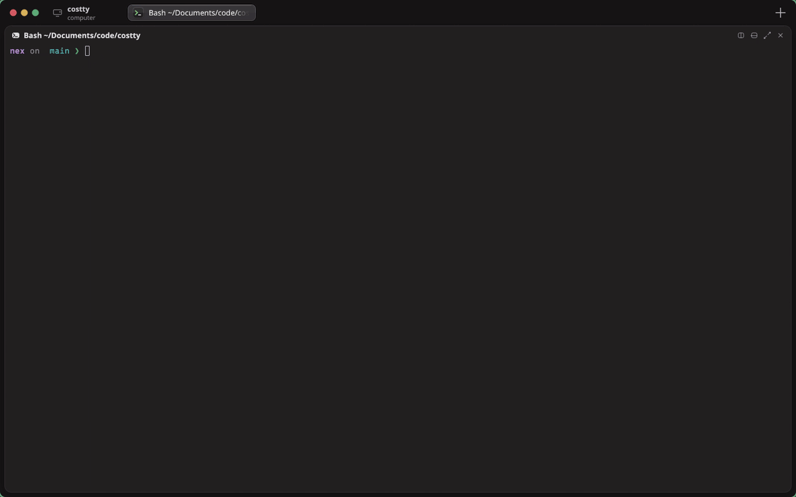

<!-- LOGO -->
<h1 align="center">
  
  <br>nex
</h1>

<p align="center">
  <strong>A fast, GPU-accelerated terminal emulator for Linux and macOS, written in Rust.</strong>
  <br />
  Tabs, split panes and a file explorer, built in. No tmux, no plugins, no setup.
  <br /><br />
  <a href="https://jramirez-codes.github.io/nex/"><strong>Website</strong></a>
  ·
  <a href="#installation">Install</a>
  ·
  <a href="#features">Features</a>
  ·
  <a href="#how-does-nex-compare">Compare</a>
  ·
  <a href="#configuration">Configuration</a>
  ·
  <a href="#keybindings">Keybindings</a>
  ·
  <a href="#faq">FAQ</a>
</p>

<p align="center">
  <a href="https://github.com/jramirez-codes/nex/releases/latest"></a>
  <a href="https://github.com/jramirez-codes/nex/actions/workflows/ci.yml"></a>
  <a href="https://github.com/jramirez-codes/nex/stargazers"></a>
  <a href="LICENSE"></a>
  
  
</p>

<p align="center">
  
</p>

## About

**nex** is a free, open-source terminal emulator for Linux and macOS that looks and feels like a native,
modern desktop app. Tabs live in the title bar, and every split pane is a rounded card with its
own header showing what's running and where. A file explorer opens right next to your shell.
The UI is drawn with the GPU, so typing, scrolling and resizing stay smooth even under heavy
TUIs like `btop`, `nvim` and `lazygit`.

It is built on [`alacritty_terminal`](https://crates.io/crates/alacritty_terminal), the same
battle-tested VT engine behind Alacritty and Zed's terminal. nex's own code covers the
rendering, input handling, multiplexing and window chrome.

> [!NOTE]
> nex is young. It runs on Linux (X11 and Wayland) and macOS; macOS support is newer.
> Expect rough edges, and please
> [open an issue](https://github.com/jramirez-codes/nex/issues) when you hit one. If nex is
> useful to you, a ⭐ helps other people find it.

### Why nex?

- **One window instead of three.** Tabs, split panes and a file explorer replace a terminal +
  tmux + file manager setup.
- **Fast.** In [our benchmark](bench/README.md), nex printed 50 MB of output 1.6× faster than
  kitty and launched 1.2× faster than GNOME Terminal.
- **Works out of the box.** A Nerd Font is embedded, config applies on save, and the defaults
  are sensible.
- **Native-feeling.** Glass tab pills, per-pane headers with app icons, smooth animations, and
  touch and pinch support.

## How does nex compare?

|                                         | nex | Alacritty | kitty    | Ghostty  | GNOME Terminal |
| --------------------------------------- | :-: | :-------: | :------: | :------: | :------------: |
| GPU-rendered                            | ✅  | ✅        | ✅       | ✅       | ❌             |
| Tabs                                    | ✅  | ❌        | ✅       | ✅       | ✅             |
| Split panes                             | ✅  | ❌        | ✅       | ✅       | ❌             |
| Built-in file explorer                  | ✅  | ❌        | ❌       | ❌       | ❌             |
| Per-pane headers (program + folder)     | ✅  | ❌        | ❌       | ❌       | ❌             |
| Nerd Font icons with nothing installed  | ✅  | ❌        | ✅       | ✅       | ❌             |
| Config applies on save                  | ✅  | ✅        | Shortcut | Shortcut | GUI only       |

### Performance

Median of several runs on the same machine (Ryzen 7 3700X, RTX 3060, Wayland), default
settings for each terminal. Lower is better. See [`bench/`](bench/README.md) to run it yourself.

| Benchmark                         | nex         | kitty   | Ghostty | GNOME Terminal |
| --------------------------------- | ----------- | ------- | ------- | -------------- |
| Print 50 MB of text, color, boxes | **0.82 s**  | 1.29 s  | 1.63 s  | 1.71 s         |
| Launch to shell                   | **272 ms**  | 840 ms  | 397 ms  | 314 ms         |
| Memory at idle                    | 115 MB      | 143 MB  | 175 MB  | **52 MB**      |

## Features

- **Tabs and splits, built in.** Split right or down, zoom a pane, drag the gaps to resize,
  and move between splits with the keyboard. Each pane's header has split, zoom and close
  buttons. You don't need tmux for layout.
- **File explorer, built in.** `Ctrl+E` splits a file explorer off the current pane, open at
  that pane's folder. The directory label in the title bar is also a Files tab of its own.
  Folders open in place, files open in their default app, and splitting an explorer starts a
  terminal in the folder you're looking at.
- **Real file management.** List or grid view, multi-select, and copy, cut and paste between
  explorers, with a right-click menu and an action bar. Drag files into another folder to move
  them, onto a terminal to type their paths, or drop them in from other apps. Name clashes get
  a `(2)` suffix instead of overwriting anything. Delete asks for confirmation first, since
  it's permanent.
- **Touch and zoom.** Pinch (touchscreen or touchpad) or Ctrl+wheel zooms a terminal's font or
  an explorer's listing. In an explorer, drag to scroll, long-press to select, and drag the
  selection into another folder, explorer or terminal pane.
- **Native-feeling chrome.** Tabs sit in a segmented track with a raised "glass" active pill,
  glossy per-app icons and titles that fade out instead of being cut off.
- **Smart titles.** Every tab and pane shows the foreground program and its directory, such as
  `Node ~/code/nex`, or the title the program sets itself.
- **GPU rendering.** Text is batched into styled runs. Box-drawing, block, braille and
  Powerline glyphs are drawn as geometry, so TUI borders and graphs line up exactly.
- **Nerd Fonts out of the box.** JetBrains Mono Nerd Font Mono is built in, so icons in nvim,
  starship and lazygit work with nothing installed. An installed Nerd Font Mono is used if
  present.
- **Full color.** 16, 256 and 24-bit truecolor, with bold, italic, underline (including
  double), strikethrough, dim and inverse.
- **Scrollback search.** `Ctrl+Shift+F` opens a floating search field that highlights every
  match and steps through them.
- **Clickable links.** Ctrl+hover underlines URLs and OSC 8 hyperlinks, and Ctrl+click opens
  them.
- **Mouse everywhere.** Selection (word, line and block), SGR mouse reporting for TUIs,
  alternate-scroll for `less` and `man`, and bracketed paste.
- **Simple config.** Ghostty-style `key = value` file that applies as soon as you save it.

<p align="center">
  
</p>

<p align="center">
  
</p>

## Installation

### Prebuilt releases

Download the latest build for x86_64 or aarch64 from the
[Releases page](https://github.com/jramirez-codes/nex/releases/latest).

**Debian / Ubuntu:**

```sh
sudo apt install ./nex_*_amd64.deb      # or nex_*_arm64.deb
```

**Any Linux (tarball):**

```sh
tar xzf nex-v*-x86_64-linux.tar.gz
./nex-v*-x86_64-linux/install.sh         # installs to ~/.local (override with PREFIX=...)
```

**macOS (Apple Silicon and Intel):** unzip `nex-v*-macos-app.zip` and drag `nex.app` to
Applications. The app isn't notarized yet, so clear the download flag once before opening it:

```sh
xattr -dr com.apple.quarantine /Applications/nex.app
```

Or use the tarball, which installs `nex.app` and the `nex` command:

```sh
tar xzf nex-v*-universal-macos.tar.gz
xattr -dr com.apple.quarantine nex-v*-universal-macos
./nex-v*-universal-macos/install.sh       # nex.app + ~/.local/bin/nex
```

Each release includes a `SHA256SUMS.txt` you can verify the downloads against.

### From source

You need Rust 1.88+ and a few system libraries. On Debian/Ubuntu:

```sh
sudo apt install build-essential libxkbcommon-dev libwayland-dev libgl1-mesa-dev fontconfig
```

On macOS you only need the Xcode command line tools (`xcode-select --install`).

Then build and install:

```sh
git clone https://github.com/jramirez-codes/nex.git
cd nex
./install.sh
```

`install.sh` builds a release binary and installs:

- the binary to `~/.local/bin/nex`;
- on Linux, a desktop entry and icon, so nex appears in your app launcher (GNOME, KDE, rofi
  and others);
- on macOS, `nex.app` in `/Applications` (or `~/Applications`; set `APP_DIR=...` to choose);
- a starter config at `~/.config/nex/config`, unless you already have one.

To run it without installing:

```sh
cargo run --release
```

## Configuration

nex reads `~/.config/nex/config` (or `$XDG_CONFIG_HOME/nex/config`), on macOS too. The
syntax is Ghostty-style `key = value`, and `#` starts a comment. Changes apply as soon as you
save the file, or press `Ctrl+Shift+,` (`Cmd+Shift+,` on macOS) to reload it by hand. `command` only affects shells started
after the change.

```ini
font-family = JetBrainsMono Nerd Font Mono   # unset = auto-pick a Nerd Font Mono
font-size = 14
adjust-cell-height = 12%

background = #1f1b1e
foreground = #d9d4dd
palette = 4=#6cb6ff                          # override any of the 16 ANSI colors

background-opacity = 0.90
unfocused-split-opacity = 0.90
cursor-style = block                         # block | bar | underline
window-controls = false                      # hide the close / minimize / maximize buttons
copy-on-select = false
clipboard-toasts = false                     # no "Copied …" / "Pasted …" toasts
animations = false                           # turn off pane and tab animations
mobile = true                                # phone-sized touch screens: tabs in a left sidebar
command = fish                               # defaults to your login shell
```

See [`config.example`](config.example) for every option.

### Command line

```sh
nex --config ~/kiosk.conf          # another config file instead of ~/.config/nex/config
nex --app-id=dev.me.Scratch        # Wayland app_id (X11 class), for window rules
nex --working-directory ~/code     # where the first shell starts
nex -e htop                        # run a program instead of the shell (the rest of the line)
```

`-e` only applies to the first pane; new tabs and splits start your shell. The window closes
when the program exits. A new window (`Ctrl+Shift+N`, `Cmd+N` on macOS) keeps `--config` and
`--app-id`.

> [!TIP]
> Translucent backgrounds look best with compositor blur. On Hyprland, set
> `decoration { blur { enabled = true } }`.

## Keybindings

nex follows Ghostty's defaults on each OS. Both tables live in
[`src/app/keymap.rs`](src/app/keymap.rs).

| Action                 | Linux                                                 | macOS                                           |
| ---------------------- | ----------------------------------------------------- | ----------------------------------------------- |
| New tab / window       | `Ctrl+Shift+T` / `Ctrl+Shift+N`                       | `Cmd+T` / `Cmd+N`                               |
| Split right / down     | `Ctrl+Shift+O` / `Ctrl+Shift+E`                       | `Cmd+D` / `Cmd+Shift+D`                         |
| Close pane             | `Ctrl+Shift+W`                                        | `Cmd+W`                                         |
| Focus split            | `Ctrl+Alt+Arrows`                                     | `Cmd+Option+Arrows`                             |
| Resize split           | `Ctrl+Shift+Alt+Arrows`                               | `Cmd+Ctrl+Arrows`                               |
| Equalize splits        | `Ctrl+Shift+Alt+=`                                    | `Cmd+Ctrl+=`                                    |
| Zoom pane              | `Ctrl+Shift+Enter`                                    | `Cmd+Shift+Enter`                               |
| Explorer split here    | `Ctrl+E`                                              | `Cmd+E`                                         |
| Next / previous tab    | `Ctrl+Tab` / `Ctrl+Shift+Tab` (or `Ctrl+PgDn/PgUp`)   | `Cmd+Shift+]` / `Cmd+Shift+[`, `Ctrl+Tab`       |
| Go to tab *N*          | `Alt+1` … `Alt+8`, `Alt+9` for the last tab           | `Cmd+1` … `Cmd+8`, `Cmd+9` for the last tab     |
| Copy / paste           | `Ctrl+Shift+C` / `Ctrl+Shift+V`, `Shift+Insert`       | `Cmd+C` / `Cmd+V`                               |
| Search scrollback      | `Ctrl+Shift+F`, then `Enter` / `Shift+Enter`, `Esc`   | `Cmd+F`, then `Enter` / `Shift+Enter`, `Esc`    |
| Scroll                 | `Shift+PgUp/PgDn/Home/End`, mouse wheel               | the same, plus `Cmd+Up` / `Cmd+Down`            |
| Font size / zoom       | `Ctrl+=` / `Ctrl+-` / `Ctrl+0`, `Ctrl+wheel`, pinch   | `Cmd+=` / `Cmd+-` / `Cmd+0`, `Cmd+wheel`, pinch |
| Clear screen           | `Ctrl+Shift+K`                                        | `Cmd+K`                                         |
| Reload config          | `Ctrl+Shift+,`                                        | `Cmd+Shift+,`                                   |
| Quit                   | `Ctrl+Shift+Q`                                        | `Cmd+Q`                                         |

On macOS, `Ctrl+C` and other Ctrl keys always go to the shell, and Option types accented
characters as usual (it isn't sent as Alt/Meta).

Mouse actions (use Cmd instead of Ctrl on macOS):

- Double-click selects a word, triple-click a line, and Alt+drag a block.
- Hold Shift to select text inside apps that capture the mouse.
- Ctrl+click opens a link.
- Middle-click closes a tab, and dragging a tab reorders it.
- Drag the gap between two panes to resize them.
- Click the directory label in the title bar to show the Files tab, click it again to go back,
  and middle-click it to close it. Ctrl+Tab cycles through it too.

### File explorer

On macOS, use Cmd where this table says Ctrl.

| Action                       | Keys / mouse                                          |
| ---------------------------- | ----------------------------------------------------- |
| Open an explorer split here  | `Ctrl+E`                                              |
| Move the selection           | Arrows, `PgUp/PgDn`, `Home/End`                       |
| Open folder or file          | `Enter`, double-click (or tap)                        |
| Parent folder                | `Backspace`, `Alt+Up`, or the ⌃ button                |
| Select                       | `Space`, Ctrl+click, Shift+click, `Ctrl+A`            |
| Copy / cut / paste files     | `Ctrl+C` / `Ctrl+X` / `Ctrl+V`                        |
| Clear selection / clipboard  | `Esc`                                                 |
| Delete (asks first)          | `Delete`                                              |
| List / grid view             | `Ctrl+G`                                              |
| Show hidden files            | `Ctrl+H`                                              |
| Zoom the listing             | `Ctrl+=` / `Ctrl+-` / `Ctrl+0`, `Ctrl+wheel`, pinch   |

- Right-click for Open, Copy, Cut, Paste here, Paste into folder, Copy path, Delete and the
  view options.
- Drag files onto a folder to move them (hold Ctrl, or Option on macOS, to copy), or onto a
  terminal to type their shell-quoted paths. Files dropped in from another app are copied
  into the folder under the pointer. Dragging files out to other apps works on Wayland, not
  yet on macOS.
- On a touchscreen, drag to scroll and long-press to start selecting. Long-press and keep
  moving (or, while selecting, drag a selected item) to drag the selection onto a folder,
  another explorer or a terminal. The action bar's Delete button asks before deleting
  anything permanently.

## FAQ

**Is nex a tmux alternative?**
For layout, yes: split panes, zoom, resize and keyboard focus between splits are built in, and
every pane shows its program and folder. nex doesn't detach sessions or run over SSH, so keep
tmux for that.

**Does nex work on Wayland and X11?**
Yes, both, including tiling compositors like Hyprland and Sway. Prebuilt `.deb` packages and
tarballs are available for x86_64 and aarch64.

**Do I need to install a Nerd Font?**
No. JetBrains Mono Nerd Font is embedded, so icons in Neovim, starship and lazygit work out of
the box. An installed Nerd Font Mono is used instead if you have one.

**Is nex available on macOS or Windows?**
macOS, yes: releases include `nex.app`, a universal build for Apple Silicon and Intel Macs
(see [Installation](#installation)). Signing and notarization are on the [roadmap](#roadmap). Windows isn't supported yet, but the platform
layer (`src/platform/`) is set up for it.

**How is nex related to Alacritty?**
nex uses `alacritty_terminal`, Alacritty's VT parser and grid, as its terminal engine. The
renderer, tabs, splits, file explorer and window chrome are nex's own.

## Architecture

```
src/
├── main.rs           window setup (eframe / winit)
├── cli.rs            command-line flags
├── config.rs         config parsing and reloading
├── app/              the application: state and frame loop (mod.rs), plus
│   ├── actions.rs        the actions and carrying them out
│   ├── keymap.rs         shortcut tables per OS (Ctrl style, Cmd style)
│   ├── keyboard.rs       keys, text and clipboard routing
│   ├── mouse.rs          selection, mouse reporting, wheel, links
│   ├── panes.rs          pane cards, headers, divider dragging
│   ├── layout.rs         binary split tree + directional focus
│   ├── titlebar.rs       window buttons, tab track, Files label
│   ├── workspace.rs      tabs, splits, opening and closing panes
│   └── …                 tab, window, zoom, metrics
├── terminal/         one terminal per pane
│   ├── mod.rs            PTY + VT state, title and cwd
│   ├── input.rs          keyboard & mouse → xterm escape sequences
│   ├── search.rs         scrollback search, URL and OSC 8 link detection
│   └── snapshot.rs       copy of the visible screen, taken under the lock
├── render/           drawing the terminal grid
│   ├── mod.rs            runs, colors, cursor, selection, search highlights
│   ├── glyphs.rs         glyph cache + per-pane mesh
│   ├── boxdraw.rs        procedural box / block / braille / Powerline glyphs
│   └── fonts.rs          font setup + embedded Nerd Font
├── file_explorer/    the explorer pane
│   ├── mod.rs            state, navigation, selection
│   ├── view.rs           path bar, listing, action bar, context menu
│   ├── input.rs          clicks, touch gestures, drags, keys
│   ├── transfer.rs       file clipboard, copy/move jobs, drops
│   ├── fs_ops.rs         listing, copying, moving, path quoting
│   └── items.rs, zoom.rs rows, tiles and pinch zoom
├── ui/               shared UI kit: theme, glide animation, painting, icons, widgets
└── platform/         everything OS-specific, behind one API (see platform/mod.rs)
    ├── mod.rs            the shared types and the per-OS switch
    ├── unix.rs           POSIX pieces shared by Linux and macOS
    ├── fontdb.rs         font lookup without fontconfig (macOS, Windows)
    ├── no_dnd.rs         drag and drop stub where winit handles it
    ├── linux/            /proc process info, fontconfig, Wayland drag and drop
    ├── macos/            libproc process info, traffic lights, starting from nex.app
    └── windows/          compiles, not supported yet
```

`packaging/macos/` holds `nex.app`'s `Info.plist`, icon and `make-app.sh`, which wraps a
binary into the app (used by `install.sh` and the release workflow).

Nothing outside `platform/` checks the OS. Porting nex to another OS means adding a folder
there that provides the same items (`platform/mod.rs` lists them).

Screenshots in `docs/screenshots/` are made by `docs/screenshots/capture.sh` (Hyprland).

## Roadmap

- [ ] Color emoji
- [ ] Quick terminal (drop-down on a global hotkey)
- [ ] Command palette
- [ ] Shell integration (OSC 7 cwd, prompt marks, jump between prompts)
- [ ] Themes collection
- [x] macOS support
- [x] macOS app bundle
- [ ] Signed and notarized macOS app
- [ ] Drag files out to Finder
- [ ] Windows support

## Acknowledgments

- [Alacritty](https://github.com/alacritty/alacritty) for `alacritty_terminal`, the VT parser
  and grid that power nex.
- [egui](https://github.com/emilk/egui) for immediate-mode GPU rendering.
- [Ghostty](https://ghostty.org) for the inspiration on defaults, keybindings and config style.
- [JetBrains Mono](https://www.jetbrains.com/lp/mono/) and [Nerd Fonts](https://www.nerdfonts.com),
  embedded under the [SIL Open Font License](assets/fonts/OFL.txt).

## Releasing

1. Bump `version` in `Cargo.toml`, and move the `Unreleased` notes in
   [`CHANGELOG.md`](CHANGELOG.md) under the new version.
2. Commit, then tag and push:

   ```sh
   git tag v0.7.1 && git push origin v0.7.1
   ```

The [release workflow](.github/workflows/release.yml) builds x86_64 and aarch64 Linux binaries
(tarballs and `.deb`s) and a universal macOS build (`nex.app` zip and a tarball), and publishes a GitHub Release
with notes taken from the changelog.

## License

nex is licensed under the [MIT License](LICENSE).
