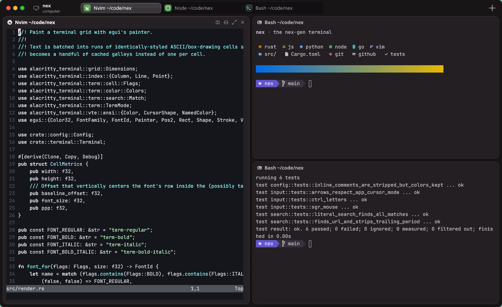
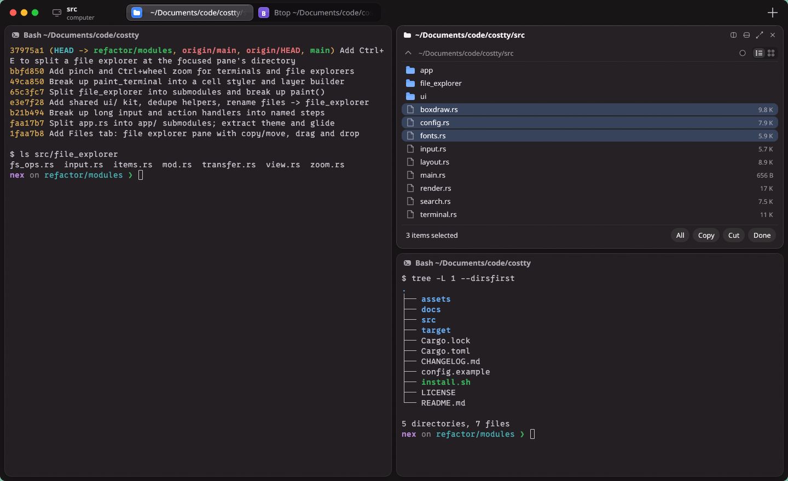
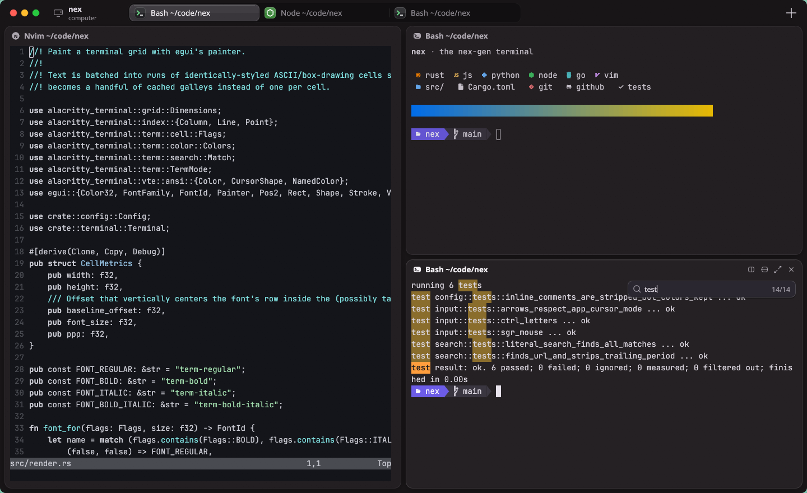

<!-- LOGO -->
<h1>
<p align="center">
  
  <br>nex
</h1>
  <p align="center">
    The nex-gen terminal.
    <br />
    Fast, GPU-rendered, with tabs and split panes built in. Written in Rust.
    <br />
    <a href="#about">About</a>
    ·
    <a href="#features">Features</a>
    ·
    <a href="#installation">Install</a>
    ·
    <a href="#configuration">Configuration</a>
    ·
    <a href="#keybindings">Keybindings</a>
    ·
    <a href="https://jramirez-codes.github.io/nex/">Website</a>
  </p>
</p>

<p align="center">
  <a href="https://github.com/jramirez-codes/nex/releases/latest"></a>
  <a href="https://github.com/jramirez-codes/nex/actions/workflows/ci.yml"></a>
  <a href="LICENSE"></a>
  
  
</p>

<p align="center">
  
</p>

## About

nex is a terminal emulator that looks and feels like a native, modern desktop app. Tabs live
in the title bar, and every split is a rounded card with its own header showing what's running
and where. The UI is drawn with the GPU, so typing, scrolling and resizing stay smooth even
under heavy TUIs like `btop` or `nvim`.

It is built on [`alacritty_terminal`](https://crates.io/crates/alacritty_terminal), the same
battle-tested VT engine behind Alacritty and Zed's terminal. nex's own code covers the
rendering, input handling, multiplexing and window chrome.

> [!NOTE]
> nex is young and Linux-only for now (X11 and Wayland). Expect rough edges, and please
> [open an issue](https://github.com/jramirez-codes/nex/issues) when you hit one.

## Features

- **Tabs and splits, built in.** Split right or down, zoom a pane, drag the gaps to resize,
  and move between splits with the keyboard. Each pane's header has split, zoom and close
  buttons. You don't need tmux for layout.
- **File explorer, built in.** `Ctrl+E` splits a file explorer off the current pane, open at
  that pane's folder. The directory label in the title bar is also a Files tab of its own.
  Folders open in place, files open in their default app, and splitting an explorer starts a
  terminal in the folder you're looking at.
- **Real file management.** List or grid view, multi-select, and copy, cut and paste between
  explorers, with a right-click menu and an action bar. Drag files into another folder to move
  them, onto a terminal to type their paths, or drop them in from other apps. Name clashes get
  a `(2)` suffix instead of overwriting anything.
- **Touch and zoom.** Pinch (touchscreen or touchpad) or Ctrl+wheel zooms a terminal's font or
  an explorer's listing. In an explorer, drag to scroll and long-press to select.
- **Native-feeling chrome.** Tabs sit in a segmented track with a raised "glass" active pill,
  glossy per-app icons and titles that fade out instead of being cut off.
- **Smart titles.** Every tab and pane shows the foreground program and its directory, such as
  `Node ~/code/nex`, or the title the program sets itself.
- **GPU rendering.** Text is batched into styled runs. Box-drawing, block, braille and
  Powerline glyphs are drawn as geometry, so TUI borders and graphs line up exactly.
- **Nerd Fonts out of the box.** JetBrains Mono Nerd Font Mono is built in, so icons in nvim,
  starship and lazygit work with nothing installed. An installed Nerd Font Mono is used if
  present.
- **Full color.** 16, 256 and 24-bit truecolor, with bold, italic, underline (including
  double), strikethrough, dim and inverse.
- **Scrollback search.** `Ctrl+Shift+F` opens a floating search field that highlights every
  match and steps through them.
- **Clickable links.** Ctrl+hover underlines URLs and OSC 8 hyperlinks, and Ctrl+click opens
  them.
- **Mouse everywhere.** Selection (word, line and block), SGR mouse reporting for TUIs,
  alternate-scroll for `less` and `man`, and bracketed paste.
- **Simple config.** Ghostty-style `key = value` file that applies as soon as you save it.

<p align="center">
  
</p>

<p align="center">
  
</p>

## Installation

### Prebuilt releases

Download the latest build for x86_64 or aarch64 from the
[Releases page](https://github.com/jramirez-codes/nex/releases/latest).

**Debian / Ubuntu:**

```sh
sudo apt install ./nex_*_amd64.deb      # or nex_*_arm64.deb
```

**Any Linux (tarball):**

```sh
tar xzf nex-v*-x86_64-linux.tar.gz
./nex-v*-x86_64-linux/install.sh         # installs to ~/.local (override with PREFIX=...)
```

Each release includes a `SHA256SUMS.txt` you can verify the downloads against.

### From source

You need Rust 1.88+ and a few system libraries. On Debian/Ubuntu:

```sh
sudo apt install build-essential libxkbcommon-dev libwayland-dev libgl1-mesa-dev fontconfig
```

Then build and install:

```sh
git clone https://github.com/jramirez-codes/nex.git
cd nex
./install.sh
```

`install.sh` builds a release binary and installs:

- the binary to `~/.local/bin/nex`;
- a desktop entry and icon, so nex appears in your app launcher (GNOME, KDE, rofi and others);
- a starter config at `~/.config/nex/config`, unless you already have one.

To run it without installing:

```sh
cargo run --release
```

## Configuration

nex reads `~/.config/nex/config` (or `$XDG_CONFIG_HOME/nex/config`). The syntax is
Ghostty-style `key = value`, and `#` starts a comment. Changes apply as soon as you save the
file, or press `Ctrl+Shift+,` to reload it by hand. `command` only affects shells started
after the change.

```ini
font-family = JetBrainsMono Nerd Font Mono   # unset = auto-pick a Nerd Font Mono
font-size = 14
adjust-cell-height = 12%

background = #1f1b1e
foreground = #d9d4dd
palette = 4=#6cb6ff                          # override any of the 16 ANSI colors

background-opacity = 0.90
unfocused-split-opacity = 0.90
cursor-style = block                         # block | bar | underline
window-controls = false                      # hide the close / minimize / maximize buttons
copy-on-select = false
animations = false                           # turn off pane and tab animations
command = fish                               # defaults to your login shell
```

See [`config.example`](config.example) for every option.

> [!TIP]
> Translucent backgrounds look best with compositor blur. On Hyprland, set
> `decoration { blur { enabled = true } }`.

## Keybindings

| Action                 | Keys                                                  |
| ---------------------- | ----------------------------------------------------- |
| New tab / window       | `Ctrl+Shift+T` / `Ctrl+Shift+N`                       |
| Split right / down     | `Ctrl+Shift+O` / `Ctrl+Shift+E`                       |
| Close pane             | `Ctrl+Shift+W`                                        |
| Focus split            | `Ctrl+Alt+Arrows`                                     |
| Resize split           | `Ctrl+Shift+Alt+Arrows`                               |
| Equalize splits        | `Ctrl+Shift+Alt+=`                                    |
| Zoom pane              | `Ctrl+Shift+Enter`                                    |
| Explorer split here    | `Ctrl+E`                                              |
| Next / previous tab    | `Ctrl+Tab` / `Ctrl+Shift+Tab` (or `Ctrl+PgDn/PgUp`)   |
| Go to tab *N*          | `Alt+1` … `Alt+8`, `Alt+9` for the last tab           |
| Copy / paste           | `Ctrl+Shift+C` / `Ctrl+Shift+V`, `Shift+Insert`       |
| Search scrollback      | `Ctrl+Shift+F`, then `Enter` / `Shift+Enter`, `Esc`   |
| Scroll                 | `Shift+PgUp/PgDn/Home/End`, mouse wheel               |
| Font size / zoom       | `Ctrl+=` / `Ctrl+-` / `Ctrl+0`, `Ctrl+wheel`, pinch   |
| Clear screen           | `Ctrl+Shift+K`                                        |
| Reload config          | `Ctrl+Shift+,`                                        |
| Quit                   | `Ctrl+Shift+Q`                                        |

Mouse actions:

- Double-click selects a word, triple-click a line, and Alt+drag a block.
- Hold Shift to select text inside apps that capture the mouse.
- Ctrl+click opens a link.
- Middle-click closes a tab, and dragging a tab reorders it.
- Drag the gap between two panes to resize them.
- Click the directory label in the title bar to show the Files tab, click it again to go back,
  and middle-click it to close it. Ctrl+Tab cycles through it too.

### File explorer

| Action                       | Keys / mouse                                          |
| ---------------------------- | ----------------------------------------------------- |
| Open an explorer split here  | `Ctrl+E`                                              |
| Move the selection           | Arrows, `PgUp/PgDn`, `Home/End`                       |
| Open folder or file          | `Enter`, double-click (or tap)                        |
| Parent folder                | `Backspace`, `Alt+Up`, or the ⌃ button                |
| Select                       | `Space`, Ctrl+click, Shift+click, `Ctrl+A`            |
| Copy / cut / paste files     | `Ctrl+C` / `Ctrl+X` / `Ctrl+V`                        |
| Clear selection / clipboard  | `Esc`                                                 |
| List / grid view             | `Ctrl+G`                                              |
| Show hidden files            | `Ctrl+H`                                              |
| Zoom the listing             | `Ctrl+=` / `Ctrl+-` / `Ctrl+0`, `Ctrl+wheel`, pinch   |

- Right-click for Open, Copy, Cut, Paste here, Paste into folder, Copy path and the view
  options.
- Drag files onto a folder to move them, or onto a terminal to type their shell-quoted paths.
  Files dropped in from another app are copied into the folder under the pointer.
- On a touchscreen, drag to scroll and long-press to start selecting.

## Architecture

```
src/
├── main.rs           window setup (eframe / winit)
├── app/              the application: state and frame loop (mod.rs), plus
│   ├── actions.rs        shortcuts and carrying out actions
│   ├── keyboard.rs       keys, text and clipboard routing
│   ├── mouse.rs          selection, mouse reporting, wheel, links
│   ├── panes.rs          pane cards, headers, divider dragging
│   ├── titlebar.rs       window buttons, tab track, Files label
│   ├── workspace.rs      tabs, splits, opening and closing panes
│   └── …                 tab, window, zoom, metrics
├── file_explorer/    the explorer pane
│   ├── mod.rs            state, navigation, selection
│   ├── view.rs           path bar, listing, action bar, context menu
│   ├── input.rs          clicks, touch gestures, drags, keys
│   ├── transfer.rs       file clipboard, copy/move jobs, drops
│   ├── fs_ops.rs         listing, copying, moving, path quoting
│   └── items.rs, zoom.rs rows, tiles and pinch zoom
├── ui/               shared UI kit: theme, glide animation, painting, icons, widgets
├── layout.rs         binary split tree + directional focus
├── terminal.rs       PTY + VT state per pane, /proc process info
├── render.rs         grid painting: runs, colors, cursor, selection, search
├── boxdraw.rs        procedural box / block / braille / Powerline glyphs
├── input.rs          keyboard & mouse → xterm escape sequences
├── search.rs         scrollback search, URL and OSC 8 link detection
├── fonts.rs          fontconfig lookup + embedded Nerd Font
└── config.rs         config parsing
```

Screenshots in `docs/screenshots/` are made by `docs/screenshots/capture.sh` (Hyprland).

## Roadmap

- [ ] Color emoji
- [ ] Quick terminal (drop-down on a global hotkey)
- [ ] Command palette
- [ ] Shell integration (OSC 7 cwd, prompt marks, jump between prompts)
- [ ] Themes collection
- [ ] macOS support

## Acknowledgments

- [Alacritty](https://github.com/alacritty/alacritty) for `alacritty_terminal`, the VT parser
  and grid that power nex.
- [egui](https://github.com/emilk/egui) for immediate-mode GPU rendering.
- [Ghostty](https://ghostty.org) for the inspiration on defaults, keybindings and config style.
- [JetBrains Mono](https://www.jetbrains.com/lp/mono/) and [Nerd Fonts](https://www.nerdfonts.com),
  embedded under the [SIL Open Font License](assets/fonts/OFL.txt).

## Releasing

1. Bump `version` in `Cargo.toml`, and move the `Unreleased` notes in
   [`CHANGELOG.md`](CHANGELOG.md) under the new version.
2. Commit, then tag and push:

   ```sh
   git tag v0.3.0 && git push origin v0.3.0
   ```

The [release workflow](.github/workflows/release.yml) builds x86_64 and aarch64 binaries, packages
tarballs and `.deb`s, and publishes a GitHub Release with notes taken from the changelog.

## License

nex is licensed under the [MIT License](LICENSE).
